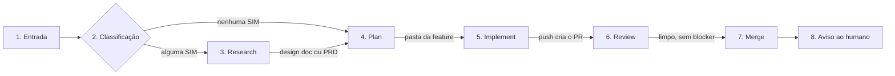

# Fábrica Agêntica

Fábrica de desenvolvimento de software feita de bots: recebe uma demanda e entrega código mergeado, passando por fases com verificação e com o humano só onde a decisão é dele.

**Dono:** Elienaldo Bittencourt · **Documentação e montagem:** Mestre de obras · **Última atualização deste README:** 2026-11-04

> **Estado:** o caminho rápido (Dev Expresso, Supervisor, Cursor e volta) já foi validado de ponta a ponta no teste real `req-20261103-001`. O fluxo padrão completo (research, plan, implement, review) está desenhado e documentado, e os testes reais dele começam em 2026-11-05 com o projeto Adega.

---

## Sumário

1. [O que é](#1-o-que-é)
2. [Objetivo](#2-objetivo)
3. [Função de cada parte](#3-função-de-cada-parte)
4. [Fases do fluxo](#4-fases-do-fluxo)
5. [Comunicação bidirecional com o Cursor](#5-comunicação-bidirecional-com-o-cursor)
6. [Pedido órfão](#6-pedido-órfão-seção-9-da-supervisor-regras)
7. [Padrões adotados](#7-padrões-adotados)
8. [Como utilizar](#8-como-utilizar)
9. [Estrutura de pastas](#9-estrutura-de-pastas)
10. [O que cada documento cobre](#10-o-que-cada-documento-cobre)
11. [Pendências e pontos em aberto](#11-pendências-e-pontos-em-aberto)

---

## 1. O que é

Um conjunto de bots do Grok Bot que trabalham em equipe com agentes de nuvem do Cursor. Os bots coordenam, decidem e controlam o fluxo. Quem escreve o código é o agente do Cursor, que roda numa VM própria, em branch própria. Cada feature roda numa **sessão nomeada**, com a sua squad, criada e destruída pelo Dr. Eggbot.

## 2. Objetivo

- Transformar uma demanda (ticket, texto, ajuste pequeno) em PR mergeado, com plano, testes e review no meio do caminho.
- Ter um só ponto de contato com o Cursor (o Supervisor) e um só canal com o humano (também o Supervisor), para tudo ficar rastreado.
- Fazer cada fase terminar com uma verificação e com critério de pronto, sem handoff sem dono nem loop sem saída.
- Manter o humano no comando: ele decide quando há impasse, blocker, risco ou merge fora do padrão.

## 3. Função de cada parte

### Peças de comunicação com o Cursor

| Parte | O que é | Função |
| --- | --- | --- |
| **Supervisor** | Bot permanente | Ponte única entre a fábrica e o Cursor, e único canal com o humano. Resolve o workspace, lança os agentes, mantém o livro-razão, casa o retorno com o pedido, avisa o humano. Não classifica, não desenha, não implementa, não revisa. Regras gerais na skill `supervisor-regras`. |
| **Dev Expresso** | Bot permanente | Caminho à parte para desenvolvimentos pequenos (fix, label, cor de botão), fora do fluxo padrão. Recebe do humano, repassa ao Supervisor, devolve ao humano o retorno completo (resumo, prints, arquivos, testes, links). Aplica o freio de escopo: pedido grande vai ao fluxo padrão. Não tem skill própria. |
| **Cursor** | Agentes de nuvem, fora do Grok Bot | Executam o trabalho de código numa VM, em branch nova, a pedido do Supervisor. Não entram em grupo de chat. |
| **Livro-razão** | Arquivo de estado do Supervisor | Registra cada pedido (`request_id`), o ID do agente (`bc-…`), grupo, feature, fase e a entrega (commit, PR). É a base do casamento do retorno. |
| **Varredura de status** | Rotina do Supervisor, a cada cerca de 10 minutos | Rede de segurança: consulta no Cursor, por ID de agente e por run, cada pedido aberto. Sem pedido aberto, sai em silêncio. |
| **Receptora de webhook** | Inativa, fora do fluxo | Rotina desenhada e nunca executada, sem uso previsto por enquanto (futuro/opcional). Não é parte da fábrica funcional: o retorno do Cursor vem pela notificação de conclusão (seção 5). Documento `automacao-receptora-cursor.md`. |

### Squad do fluxo padrão

| Bot | Função |
| --- | --- |
| **Dr. Eggbot** | Cria e destrói sessões, agentes e grupos de chat de cada feature. |
| **Principal Product Engineer** | Guardião do escopo: classifica a demanda com 3 perguntas, roteia as skills e orquestra o research. |
| **Product Engineer** | No research, traz a visão técnica e de produto, com o mesmo peso de voto do Principal. |
| **Design de front-end** | Desenha a experiência do front no research. |
| **Advogado do diabo** | Levanta objeções justificadas no research. Não vota; trava a fase enquanto houver objeção sem resposta. |
| **Orquestrador de pipeline** | Conduz plan, implement e review: recebe os insumos do Supervisor (nunca direto do Principal), devolve a ele o pedido ao Cursor e faz o merge. |
| **Curador amigável** | Transforma o resultado do review em HTML visual e simples para o humano decidir. |
| **Cirurgião** | Corrige should fix e nit. Blocker só com autorização do humano. |
| **Mestre de obras** | Desenha, documenta, configura e testa a própria fábrica. Não faz parte do fluxo de uma feature. |

### Skills usadas pelos agentes do Cursor

`TLC Spec Lean` (plan e implement; o Verifier faz parte dela), `the-judge` (review do PR), `tlc-prd` e `tlc-discover` (saída do research), `wayfinder`, `grill-me` e `prototype` (opcionais). O detalhe de cada uma está em `markdown/modelos/fábrica-agêntica.md`, seção 4.

## 4. Fases do fluxo



| Fase | Quem faz | O que acontece | O que sai |
| --- | --- | --- | --- |
| 1. Entrada | Supervisor, Dr. Eggbot | Recebe a demanda, pergunta o projeto só se faltar, abre a sessão e a branch, pede o Principal Product Engineer. | feature |
| 2. Classificação | Principal Product Engineer | 3 perguntas: muda arquitetura? mexe em mais de um serviço? requisito ambíguo? Nenhum SIM é simples e vai direto ao plan; um SIM é média; dois ou três SIM, ou produto novo, é alta. O humano pode fixar o nível com uma tag. | rota |
| 3. Research (a fase de busca) | Principal, Product Engineer, design de front-end, advogado do diabo | Decisão em consenso, no máximo 2 rodadas; sem consenso, o humano decide. | PRD (média) ou design doc (alta) |
| 4. Plan | Orquestrador, Cursor com TLC Spec Lean | Sessão nova de contexto limpo; sempre pede plano e checks. | `plan.md`, `checks.md`, `verification.md`, `STATE.md`, `LESSONS.md` |
| 5. Implement | Orquestrador, Cursor com TLC Spec Lean | Build, testes e verificação dentro da skill. Teste vermelho é parada, e a asserção nunca é enfraquecida. No máximo 3 rodadas de correção; depois, escala ao humano. | PR |
| 6. Review | Orquestrador, Cursor com the-judge, Curador, Cirurgião | A the-judge classifica em blocker, should fix e nit (máx. 3 rodadas por execução). O Cirurgião corrige should fix e nit (máx. 3 rodadas). Blocker e should fix complexo vão ao humano. | findings, HTML |
| 7. Merge | Orquestrador | Merge no GitHub quando a última rodada da the-judge vem limpa e sem blocker pendente (nit pode ficar). | PR mergeado |
| 8. Aviso | Supervisor | Avisa o humano; depois do ok, o Dr. Eggbot destrói a sessão. | aviso |

**Sessão nova em toda fase:** Toda fase nova (research, plan, implement e review) começa com o Supervisor solicitando ao Cursor que abra uma nova sessão, com contexto limpo, sem exceção. O handoff entre fases passa sempre pelo Supervisor, que dispara a sessão nova.

**Caminho rápido (Dev Expresso):** o humano pede o ajuste, o Dev Expresso passa ao Supervisor, o Cursor executa em branch `fix/YYYYMMDD-nome-da-task` e sobe no dev, e o retorno volta ao humano pelo mesmo caminho. Branch e PR só com a aprovação do humano.

## 5. Comunicação bidirecional com o Cursor

**Ida.** Só o Supervisor lança agentes no Cursor, pela API v1 de agentes. O título do agente segue `slug-fase-request_id`. Ao lançar, o Supervisor grava o **ID do agente** no livro-razão, junto do pedido.

**Volta.** O canal oficial é a notificação de conclusão, sem webhook. Quando o agente termina, o Cursor envia uma **notificação de conclusão do agente de nuvem**, que acorda o Supervisor. Exemplo real (teste `req-20261103-001`, trechos cortados com …):

```
Background task "Cloud agent bc-e3674a19-1e58-53b1-bbfa-eb88e2276620" (cursor-agent) finished:
The Cursor agent finished.
Agent: https://cursor.com/agents/bc-e3674a19-1e58-53b1-bbfa-eb88e2276620
No pull request link is available yet (the agent may have made no changes, or the PR is still being created).

Summary from the Cursor agent:
A branch `fix/20261103-versao-adega-v1-1` está no remoto, com o commit `44836f8`. …


## Arquivos … ## Testes e build … ## Como ver …
```

| Vem na notificação | Não vem |
| --- | --- |
| Status de conclusão (`finished`) | slug |
| ID do agente (`bc-…`), no título e no link | `request_id` |
| Resumo com branch, commit, arquivos, testes e como ver | ID do modelo usado |
| Aviso de PR ainda não disponível | duração da execução |
| Duas imagens (prints do agente) | link de PR |

**Casamento por ID do agente.** O Supervisor extrai o ID do título ou do link e procura exatamente esse ID no livro-razão. Com um único pedido casado, marca como entregue e repassa ao Dev Expresso (ou ao bot da fase) o resumo e ao humano o aviso com as imagens. Nunca casa por nome, slug, branch ou repositório.

**Repasse ao Dev Expresso (decisão de 2026-11-05).** Quando a solicitação parte do Dev Expresso e o Supervisor a recebe, ele replica a mensagem da mesma forma que recebeu, sem reinterpretar, sem formato fixo de `BRANCH:` e `COMMIT:` e sem anexar imagens por conta própria.

**Rede de segurança.** A varredura de status consulta cada pedido aberto por ID e run, cobrindo erro, timeout e notificação perdida. Uma checagem diária de órfãos, que lista os agentes do Cursor e compara com o livro-razão (com filtro de janela de 24 horas, repositórios da fábrica e prefixo do título para não dar falso alarme, e só avisando), está **recomendada e ainda não implementada**.

Detalhes completos: `markdown/automacoes/comunicacao-bidirecional-cursor.md`.

## 6. Pedido órfão (seção 9 da `supervisor-regras`)

Se uma notificação de conclusão chegar e o ID do agente não casar com nenhum registro do livro-razão (ID não encontrado, ou gravação que falhou no lançamento):

1. O Supervisor avisa o humano, no chat dele, com os dados da notificação: branch, commit, arquivos e o link com o ID do agente.
2. Nunca entrega a ninguém sem casamento único.
3. O humano identifica o pedido manualmente, pela branch (padronizada com data por solicitação) ou indo ao repositório.

## 7. Padrões adotados

- **Branch por solicitação, com data:** toda nova solicitação ganha branch nova, nunca a `main` e nunca a de outra solicitação. Padrão `feat/YYYYMMDD-nome-da-task` ou `fix/YYYYMMDD-nome-da-task`. O slug sai das palavras principais do pedido, com até uns três termos. Exemplo real: `fix/20261103-versao-adega-v1-1`.
- **Modelo padrão: o modelo atual (default) do Cursor**, sem nomear versão, porque a fábrica usa o Cursor como background de desenvolvimento e planejamento. Se o humano pedir outro modelo no início, ele segue em todas as fases; a troca no meio do fluxo não é automática.
- **Modelo com créditos esgotados:** se o humano pedir um modelo cujos créditos já acabaram, o Supervisor (e o Dev Expresso) avisa que ele não pode ser usado, sugere o modelo padrão atual (default) do Cursor e não lança com o modelo esgotado.
- **Status por ID:** sempre por ID de agente e por run, nunca consulta global.
- **Sem agente real em teste sem o ok do humano; sem expor a chave `CURSOR_API_KEY`; sem relançar em laço após erro.**
- **Visualização de UI:** o prompt de lançamento exige URL pública (túnel) quando o agente sobe servidor de desenvolvimento; sem ela, o Supervisor avisa que só há prints. A VM do agente não tem tempo de vida garantido: ver na hora da entrega.
- **Criação de bots sempre pelo modelo:** cada bot nasce da ficha em `markdown/modelos/`. Sem ficha, o Dr. Eggbot não cria.
- **Backup antes de alterar:** todo documento alterado ganha cópia `-anterior`; só valem os arquivos sem esse sufixo.
- **Limites de rodadas, contados separadamente:** research 2, implement 3, the-judge 3 por execução, Cirurgião 3.
- **Regra de ouro de atualização (dono: Mestre de obras):** toda atualização de regra de um bot é conduzida pelo Mestre de obras e exige, no mesmo trabalho, atualizar a documentação do projeto e a biblioteca correspondente (skill ou perfil), com backup e hash antes/depois; vale para todos os trabalhos futuros.

## 8. Como utilizar

**Ajuste pequeno (caminho rápido):**
1. Fale com o Dev Expresso, no app do Grok Bot, descrevendo o ajuste e o projeto.
2. Ele confirma o que entendeu, aplica o freio de escopo e repassa ao Supervisor.
3. O Supervisor lança o agente do Cursor em branch nova e acompanha.
4. Você recebe, pelo Dev Expresso, o resumo, os prints, os arquivos, os testes e os links. Dê o retorno em bate-volta até aprovar.
5. Só então autorize PR e merge.

**Feature (fluxo padrão):**
1. Entregue a demanda ao Supervisor (ticket, texto ou outra fonte). Informe o projeto, se ele perguntar.
2. Opcional: diga o nível na solicitação ("aceite como média") e o modelo desejado.
3. Acompanhe pelo Supervisor, que é o único que fala com você. Decida quando ele escalar (impasse, blocker, risco).
4. No merge, receba o aviso e dê o ok para o Dr. Eggbot destruir a sessão.

**Quando algo não casar:** vale a seção 6. Procure o pedido pela branch ou pelo repositório.

## 9. Estrutura de pastas

```
Fabrica-Agentica/
├── README.md
├── skills/
│   └── supervisor-regras.md          # regras gerais do Supervisor (seções 1 a 9)
├── contratos/
│   └── execucao-verificacao/
│       └── fluxo-contrato-verificacao.md
├── excalidraw/
│   ├── research/  plan/  implement/  review/   # diagramas das fases
│   ├── contrato/                               # diagrama do contrato de execução e verificação
│   ├── acompanhamento/                         # ciclo Cursor-GrokBot e testes de comunicação
│   └── LINKS.md                                # links excalidraw.com (anteriores a 01/11)
└── markdown/
    ├── comunicacao.md                # grupos de chat e quem fala com quem
    ├── fases/                        # registro em texto de cada fase
    ├── modelos/                      # ficha de cada bot e visão geral da fábrica
    ├── regras/                       # convenções
    └── automacoes/                   # comunicação com o Cursor (receptora de webhook inativa)
```

Arquivos com sufixo `-anterior` (em qualquer pasta) são backups e não valem.

## 10. O que cada documento cobre

| Documento | O que cobre |
| --- | --- |
| `markdown/modelos/fábrica-agêntica.md` | Visão geral: as 8 fases, regras gerais (sessão por feature, consenso, classificação, limites, regras para o humano, roteamento de skills), política de modelos, as skills e o ciclo de vida da squad. |
| `markdown/modelos/<bot>.md` | Ficha de cada bot: nome, job único, anti-jobs, voz, quando acorda, como concreto e ciclo de vida. Bots: Supervisor, Dev Expresso, Dr. Eggbot, Principal Product Engineer, Product Engineer, Design de front-end, Advogado do diabo, Orquestrador de pipeline, Curador amigável e Cirurgião. |
| `markdown/modelos/dashboard-benchmarks.html` | Painel de benchmarks de modelos. |
| `markdown/comunicacao.md` | Grupos de chat (permanente, direção, research, review), pares de comunicação, roteamento, nome dos canais e histórico. |
| `markdown/fases/fase-*.md` | Registro em texto dos diagramas de cada fase (research, plan, implement, PR). As versões `fase-research-v1.md` e `fase-plan-v1.md` são histórico. |
| `markdown/regras/convencoes-fabrica.md` | Padrão de branch, roteamento por grupo, campos que a notificação de conclusão não traz, criação de bots pelo modelo e modelo padrão. |
| `markdown/automacoes/comunicacao-bidirecional-cursor.md` | Fluxo real da ida e da volta com o Cursor: passo a passo, payload, o que vem e o que não vem, casamento, pedido órfão e varredura. |
| `markdown/automacoes/automacao-receptora-cursor.md` | Desenho da receptora única de webhooks. Inativa, sem uso previsto por enquanto (futuro/opcional); fora do fluxo. |
| `contratos/execucao-verificacao/fluxo-contrato-verificacao.md` | Contrato de execução e verificação: as 8 fases, quem faz, o artefato de cada uma e os limites de rodadas. |
| `skills/supervisor-regras.md` | Regras do Supervisor: workspace, consulta de status, canal com o humano, autonomia, na dúvida, política de VM, modelo esgotado e pedido órfão. |
| `excalidraw/**/*.excalidraw` | Diagramas de cada fase, do contrato e do acompanhamento da comunicação. |

## 11. Pendências e pontos em aberto

- Testes reais do fluxo padrão com o projeto Adega, a partir de 2026-11-05.
- Checagem diária de órfãos (recomendada, não implementada).
- Modelo explícito no lançamento.
- Confirmar no teste real como o push cria o PR (configuração do Cursor ou do GitHub) e se a notificação traz o link do PR (cadeia da implement à review, `comunicacao-bidirecional-cursor.md`, seção 8).
- Saldo da conta do Cursor para os testes reais.
- Pontos em aberto de `comunicacao.md` (prefixo `feat`, dono do ADR, abertura e fechamento dos grupos).
