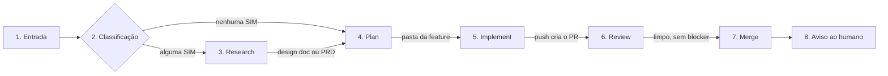

# Fábrica Agêntica

Fábrica de desenvolvimento de software feita de bots: recebe uma demanda e entrega código mergeado, passando por fases com verificação e com o humano só onde a decisão é dele.

**Dono:** Elienaldo Bittencourt · **Última atualização deste README:** 2026-11-13

**Caminho do projeto:** `C:\Users\Elienaldo\Projetos\Fabrica-Agentica`  
**Scripts operacionais (fora deste repositório):** `C:\Users\Elienaldo\GrokBot-Scripts`

> **Estado atual:** o caminho rápido (Dev Expresso, Supervisor, Cursor e volta) foi validado de ponta a ponta no teste real `req-20261103-001`. O fluxo padrão (research, plan, implement, review) também foi testado de ponta a ponta no projeto Adega, com a feature `fix-fornecedores-layout-prototipo`: PRD, plano congelado com checks, implementação com 83 checks verificados, review e merge do [PR #5](https://github.com/Elienaldo/Adega/pull/5) em 08/11/2026, 19:13 (America/Bahia). O script local de **criação** de seção existe e é o procedimento operacional do Supervisor. A **destruição** usa só a rota de API interna (`destruir-secao-api.py --api-real` + `grokbot_api_client.py`), rota única desde 12/11/2026 (a rota de tela/UIA foi aposentada). Bots e seção foram validados em 12/11/2026 (Stages A e B) e a exclusão de grupos (`room_delete`) em 13/11/2026, 19:39 (America/Bahia), num grupo descartável. A primeira destruição real (feature `feat-ambiente-dev-testes-locais`, execução `49b58340`, 13/11/2026 19:29) apagou seção e bots; os 5 grupos dessa feature continuam pendentes (ver seção 14). Toda exclusão real exige autorização humana explícita de alvo e alcance.

## Novidades (12–13/11/2026)

- **Comunicação sem grupo de direção (13/11/2026, 16:55).** Cada feature tem um canal `canal-<nome-da-feature>` (Supervisor e o humano que pediu), criado pelo Supervisor antes de tudo, em qualquer caminho (inclusive o expresso), e um grupo por fase `<fase>-<nome-da-feature>`, aberto quando a fase começa. Detalhe na seção 4 e em `markdown/comunicacao.md`. Registro: `markdown/decisoes/secao-por-fase-e-ajustes-supervisor-2026-11-13.md`.
- **Destruição por API interna validada, inclusive grupos.** Stages A e B em 12/11/2026; `room_delete` em 13/11/2026 19:39 (evidência em `C:\Users\Elienaldo\GrokBot-Scripts\diagnostico-apiinterna-stage6-1113\`). Ver seção 7.
- **Consumo de tokens 8/11 × 13/11.** Dois painéis novos em `docs/consumo/`. Resumo na seção 13.

1. **Supervisor em 3 camadas.** A biblioteca de regras não é mais um arquivo único. Camada 1: skill `supervisor-regras` (núcleo sempre presente, com o essencial, o gatilho de carregamento por fase e o índice dos blocos). Camada 2: 8 skills por função, carregadas só quando o Supervisor assume aquela função — `supervisor-fases`, `supervisor-research`, `supervisor-review-merge`, `supervisor-criacao-secao`, `supervisor-destruicao`, `supervisor-operacao-cursor`, `supervisor-comunicacao-humana` e `supervisor-logs`. Camada 3: documentos de fase em `markdown/fases`, anexados sob demanda. Nenhum gate, autorização ou validação humana foi removido. A divisão trouxe uma redução grande do prefixo fixo (estimativa do Elienaldo: ~60%, ~7.700 tokens por turno).
2. **Regra 28 adaptada individualmente.** Cada bot carrega a regra 28 (conversa nova por fase e handoff enxuto) na própria ficha, sem referências a seções que só existem no Supervisor. Descrições vivas: Dev Expresso, Grok Bot, Âncora, Dr. Eggbot e Mestre de obras. Fichas: Principal, Orquestrador, Dev Expresso, Dr. Eggbot, Âncora, Advogado do diabo, Cirurgião, Curador, Design de front-end e Product Engineer. O Supervisor mantém a versão dele em `supervisor-fases` (camada 2), porque as seções existem nele. Radar fica fora da regra 28.
3. **Sem modelo base.** Não existe mais modelo base comum. Cada bot carrega a própria regra 28 e o log de tokens na sua ficha em `markdown/modelos/`. O arquivo `_modelo-base-bot.md` foi apagado em 13/11/2026 (backup em `backups/modelo-base-remocao-20261113-001541/`, SHA `7AF28F9E`).
4. **Quem instala as skills é o modelo do Cursor** (corrigido em `markdown/modelos/fábrica-agêntica.md` e em `contratos/execucao-verificacao/fluxo-contrato-verificacao.md`).
5. **Dev Expresso avaliado para camadas (12/11/2026):** prefixo fixo ~1.692 tokens (descrição viva, 6.766 caracteres; ficha 6.593), sem handoff entre fases e com comunicação só com o Supervisor no caminho rápido. A divisão em camadas não foi aplicada.
6. **Principal e Orquestrador:** por decisão do Elienaldo em 12/11/2026, não foram divididos em camadas. As fichas só receberam a adaptação da regra 28 em 13/11/2026 (não estão com o hash de antes dessa adaptação).
7. **Conflitos de documentação (12–13/11).** Corrigidos: a regra 28 que citava seções inexistentes fora do Supervisor; quem instala as skills; neste README, o modelo padrão do Cursor (agora grok-4.7, reasoning_effort high, fast false, context 500k, e não mais “o modelo atual (default)” sem nomear versão) e a apresentação das regras do Supervisor como um único arquivo de seções 1 a 27. A distinção entre skills do Supervisor e descrição/ficha dos demais bots, e as referências ao arquivo antigo de regras fora deste README, foram alinhadas nos docs do projeto neste mesmo trabalho. Skills `supervisor-*` e descrições vivas não foram alteradas nesta passagem.

---

## Sumário

- [Novidades (12–13/11/2026)](#novidades-12–13112026)

1. [O que é](#1-o-que-é)
2. [Objetivo](#2-objetivo)
3. [Função de cada parte](#3-função-de-cada-parte)
4. [Fases do fluxo](#4-fases-do-fluxo)
5. [Comunicação bidirecional com o Cursor](#5-comunicação-bidirecional-com-o-cursor)
6. [Pedido órfão](#6-pedido-órfão-seção-9-de-supervisor-operacao-cursor)
7. [Seções por feature](#7-seções-por-feature)
8. [Padrões adotados](#8-padrões-adotados)
9. [Como utilizar](#9-como-utilizar)
10. [Estrutura de pastas](#10-estrutura-de-pastas)
11. [O que cada documento cobre](#11-o-que-cada-documento-cobre)
12. [Onde vive cada coisa](#12-onde-vive-cada-coisa)
13. [Consumo de tokens](#13-consumo-de-tokens)
14. [Pendências e pontos em aberto](#14-pendências-e-pontos-em-aberto)

---

## 1. O que é

Um conjunto de bots do Grok Bot que trabalham em equipe com agentes de nuvem do Cursor. Os bots coordenam, decidem e controlam o fluxo. Quem escreve o código é o agente do Cursor, que roda numa VM própria, em branch própria. Cada feature roda numa **seção** da barra lateral, com a sua squad. A **criação** e a **destruição** da seção são iniciadas pelo Supervisor, via script local no PC, nas condições da seção 23 de `skills/supervisor-criacao-secao.md` e da seção 24 de `skills/supervisor-destruicao.md`. O Dr. Eggbot cria bots e equipes; **não participa da destruição**.

## 2. Objetivo

- Transformar uma demanda (ticket, texto, ajuste pequeno) em PR mergeado, com plano, testes e review no meio do caminho.
- Ter um só ponto de contato com o Cursor (o Supervisor) e um só canal com o humano (também o Supervisor), para tudo ficar rastreado.
- Fazer cada fase terminar com uma verificação e com critério de pronto, sem handoff sem dono nem loop sem saída.
- Manter o humano no comando: ele decide quando há impasse, blocker, risco, validação de protótipo ou merge fora do padrão.

## 3. Função de cada parte

### Peças de comunicação com o Cursor

| Parte | O que é | Função |
| --- | --- | --- |
| **Supervisor** | Bot permanente | Ponte única entre a fábrica e o Cursor, e único canal com o humano. Resolve o workspace, lança os agentes, mantém o livro-razão, casa o retorno com o pedido, avisa o humano. Inicia a criação e a destruição local da seção, quando autorizadas e, no caso da destruição, com capacidades validadas. Não classifica, não desenha, não implementa, não revisa. Regras em 3 camadas: skill `supervisor-regras` (camada 1, núcleo + gatilho por fase + índice) e 8 skills de camada 2, carregadas só quando ele assume aquela função. |
| **Dev Expresso** | Bot permanente | Caminho à parte para desenvolvimentos pequenos (fix, label, cor de botão), fora do fluxo padrão. Recebe do humano, repassa ao Supervisor, devolve ao humano o retorno completo (resumo, prints, arquivos, testes, links). Aplica o freio de escopo: pedido grande vai ao fluxo padrão. Não tem skill própria. |
| **Cursor** | Agentes de nuvem, fora do Grok Bot | Executam o trabalho de código numa VM, em branch nova, a pedido do Supervisor. Não entram em grupo de chat. |
| **Livro-razão** | Arquivo de estado do Supervisor | Registra cada pedido (`request_id`), o ID do agente (`bc-…`), grupo, feature, fase e a entrega (commit, PR). É a base do casamento do retorno. |
| **Varredura de status** | Rotina do Supervisor, a cada cerca de 10 minutos | Rede de segurança: consulta no Cursor, por ID de agente e por run, cada pedido aberto. Sem pedido aberto, sai em silêncio. |
| **Receptora de webhook do Cursor** | Inativa, fora do fluxo | Rotina desenhada e nunca executada, sem uso previsto por enquanto (futuro/opcional). O retorno do Cursor vem pela notificação de conclusão (seção 5). Documento `automacao-receptora-cursor.md`. |

### Squad do fluxo padrão

| Bot | Função |
| --- | --- |
| **Dr. Eggbot** | Cria a equipe e os grupos da feature, depois da seção vazia existir. Não inicia nem executa a destruição. |
| **Principal Product Engineer** | Guardião do escopo: classifica a demanda, roteia as skills e orquestra o research. |
| **Product Engineer** | No research, traz a visão técnica e de produto, com o mesmo peso de voto do Principal. |
| **Design de front-end** | Desenha a experiência do front no research e o protótipo descartável, quando houver dúvida visual. |
| **Advogado do diabo** | Levanta objeções justificadas no research. Não vota; trava a fase enquanto houver objeção sem resposta. |
| **Orquestrador de pipeline** | Conduz plan, implement e review: recebe os insumos do Supervisor (nunca direto do Principal), devolve a ele o pedido ao Cursor e faz o merge. |
| **Curador amigável** | Transforma o resultado do review em HTML visual e simples para o humano decidir. |
| **Cirurgião** | Corrige should fix e nit. Blocker só com autorização do humano. |
| **Âncora** | Bot permanente de apoio à UI. O script de criação usa a Âncora para abrir a seção nova e a devolve à seção Fábrica Agêntica. Não faz parte da squad da feature. É protegida contra destruição. |
| **Mestre de obras** | Desenha, documenta, configura e testa a própria fábrica. Não faz parte do fluxo de uma feature. |

### Skills usadas pelos agentes do Cursor

`TLC Spec Lean` (`tlc-spec-lean`, plan e implement; o **Verifier** é subagente interno dela, não é fase nem bot separado), `the-judge` (review do PR), `tlc-prd` e `tlc-discover` (saída do research), `wayfinder`, `grill-me` e `prototype` (opcionais). O detalhe de cada uma está em `markdown/modelos/fábrica-agêntica.md`, seção 4. Quem instala as skills é o modelo do Cursor.

## 4. Fases do fluxo



| Fase | Quem faz | O que acontece | O que sai |
| --- | --- | --- | --- |
| 1. Entrada | Supervisor, Dr. Eggbot | O Supervisor recebe a demanda, pergunta o projeto só se faltar, cria a seção da feature pelo script local (seção 7) e só então pede os bots ao Dr. Eggbot. Abre a branch e pede o Principal Product Engineer. | feature e seção |
| 2. Classificação | Principal Product Engineer | Na visão atual (`fábrica-agêntica.md`): 5 perguntas (arquitetura; mais de um serviço ou componente compartilhado; requisito ambíguo; difícil de desfazer; autenticação, dados pessoais ou segredos). Nenhum SIM é simples e vai direto ao plan; um ou dois SIM é média; três ou mais SIM, ou produto novo, é alta. SIM nas perguntas 4 ou 5 dá no mínimo média. O humano pode fixar o nível com uma tag. Ver pendência sobre textos que ainda citam 3 perguntas. | rota |
| 3. Research (a fase de busca) | Principal, Product Engineer, design de front-end, advogado do diabo | Decisão em consenso, no máximo 2 rodadas; sem consenso, o humano decide. Entrevista obrigatória, quando houver, interrompe o avanço. O OK humano do protótipo é obrigatório antes do plan (seção 22 de `supervisor-fases`). | PRD (média) ou design doc (alta) |
| 4. Plan | Orquestrador, Cursor com TLC Spec Lean | Sessão nova de contexto limpo; sempre pede plano e checks. Só começa depois do OK do protótipo, quando houve research com protótipo. | `plan.md`, `checks.md`, `verification.md`, `STATE.md`, `LESSONS.md` |
| 5. Implement | Orquestrador, Cursor com TLC Spec Lean | Build, testes e verificação dentro da skill (Verifier interno). Teste vermelho é parada, e a asserção nunca é enfraquecida. No máximo 3 rodadas de correção; depois, escala ao humano. | PR |
| 6. Review | Orquestrador, Cursor com the-judge, Curador, Cirurgião | A the-judge classifica em blocker, should fix e nit (máx. 3 rodadas por execução). O Cirurgião corrige should fix e nit (máx. 3 rodadas). Blocker e should fix complexo vão ao humano. | findings, HTML |
| 7. Merge | Orquestrador | Merge no GitHub quando a última rodada da the-judge vem limpa e sem blocker pendente (nit pode ficar). | PR mergeado |
| 8. Aviso | Supervisor | Avisa o humano. A destruição só pode ser iniciada pelo Supervisor via script local, com autorização explícita de alvo e alcance e com capacidades validadas, conforme a seção 24 de `supervisor-destruicao`. O merge, por si só, não autoriza destruir. A rota de API interna está validada (seção 7). | aviso |

**Sessão nova em toda fase:** Toda fase nova (research, plan, implement e review) começa com o Supervisor solicitando ao Cursor que abra uma nova sessão, com contexto limpo, sem exceção. O handoff entre fases passa sempre pelo Supervisor, que dispara a sessão nova.

**Regra 28 — conversa nova por fase e handoff enxuto (decisão de 11/11/2026).** Cada fase começa em conversa nova, sem arrastar o histórico da anterior. O handoff leva só a decisão e o link do artefato. Cada bot carrega a sua versão da regra na própria ficha (o Supervisor, em `supervisor-fases`). O Radar fica fora. Motivo: a auditoria de consumo mostrou que o cache relido é a maior parte do gasto (seção 13).

### Comunicação da feature (decisão de 13/11/2026)

- **Não existe grupo de direção.** O que passava por ele (Supervisor↔Principal, Supervisor↔Orquestrador, entrega de insumos, pedidos ao Cursor, falhas e escaladas) acontece no grupo da fase em curso.
- **Canal da feature:** `canal-<nome-da-feature>`, com o Supervisor e o humano que pediu. O Supervisor cria antes de tudo, em qualquer caminho, inclusive o expresso. O Dev Expresso não abre grupo inicial próprio.
- **Um grupo por fase:** `<fase>-<nome-da-feature>`, aberto quando a fase começa. Plan, implement e review: Supervisor, Orquestrador de pipeline e a equipe da fase (na review, Cirurgião e Curador amigável). O grupo de review abre quando a review começa.
- **Research:** o grupo nasce junto com os agentes de research (Principal, Product Engineer, Design de front-end e Advogado do diabo). Pelo `markdown/comunicacao.md`, o Supervisor não entra nele; insumos e resultado passam pelo Principal.
- **Grupo permanente** Supervisor e Dr. Eggbot, fora das features.
- Grupos antigos com nome `<feature>-AAAAMMDD.direção` ainda podem existir; o script de destruição reconhece esse nome legado para limpá-los.

**Caminho rápido (Dev Expresso):** o humano pede o ajuste, o Dev Expresso passa ao Supervisor, o Cursor executa em branch `fix/YYYYMMDD-nome-da-task` e sobe no dev, e o retorno volta ao humano pelo mesmo caminho. Branch e PR só com a aprovação do humano.

## 5. Comunicação bidirecional com o Cursor

**Ida.** Só o Supervisor lança agentes no Cursor, pela API v1 de agentes. O título do agente segue `slug-fase-request_id`. Ao lançar, o Supervisor grava o **ID do agente** no livro-razão, junto do pedido.

**Volta.** O canal oficial é a notificação de conclusão, sem webhook. Quando o agente termina, o Cursor envia uma **notificação de conclusão do agente de nuvem**, que acorda o Supervisor. Exemplo real (teste `req-20261103-001`, trechos cortados com …):

```
Background task "Cloud agent bc-e3674a19-1e58-53b1-bbfa-eb88e2276620" (cursor-agent) finished:
The Cursor agent finished.
Agent: https://cursor.com/agents/bc-e3674a19-1e58-53b1-bbfa-eb88e2276620
No pull request link is available yet (the agent may have made no changes, or the PR is still being created).

Summary from the Cursor agent:
A branch `fix/20261103-versao-adega-v1-1` está no remoto, com o commit `44836f8`. …


## Arquivos … ## Testes e build … ## Como ver …
```

| Vem na notificação | Não vem |
| --- | --- |
| Status de conclusão (`finished`) | slug |
| ID do agente (`bc-…`), no título e no link | `request_id` |
| Resumo com branch, commit, arquivos, testes e como ver | ID do modelo usado |
| Aviso de PR ainda não disponível | duração da execução |
| Duas imagens (prints do agente) | link de PR |

**Casamento por ID do agente.** O Supervisor extrai o ID do título ou do link e procura exatamente esse ID no livro-razão. Com um único pedido casado, marca como entregue e repassa ao Dev Expresso (ou ao bot da fase) o resumo e ao humano o aviso com as imagens. Nunca casa por nome, slug, branch ou repositório.

**Repasse ao Dev Expresso (decisão de 2026-11-05).** Quando a solicitação parte do Dev Expresso e o Supervisor a recebe, ele replica a mensagem da mesma forma que recebeu, sem reinterpretar, sem formato fixo de `BRANCH:` e `COMMIT:` e sem anexar imagens por conta própria.

**Rede de segurança.** A varredura de status consulta cada pedido aberto por ID e run, cobrindo erro, timeout e notificação perdida. Uma checagem diária de órfãos, que lista os agentes do Cursor e compara com o livro-razão (com filtro de janela de 24 horas, repositórios da fábrica e prefixo do título para não dar falso alarme, e só avisando), está **recomendada e ainda não implementada**.

Detalhes completos: `markdown/automacoes/comunicacao-bidirecional-cursor.md`.

## 6. Pedido órfão (seção 9 de `supervisor-operacao-cursor`)

Se uma notificação de conclusão chegar e o ID do agente não casar com nenhum registro do livro-razão (ID não encontrado, ou gravação que falhou no lançamento):

1. O Supervisor avisa o humano, no chat dele, com os dados da notificação: branch, commit, arquivos e o link com o ID do agente.
2. Nunca entrega a ninguém sem casamento único.
3. O humano identifica o pedido manualmente, pela branch (padronizada com data por solicitação) ou indo ao repositório.

## 7. Seções por feature

**Seção** é o agrupamento de bots na barra lateral. Não é sessão de execução do Cursor.

### Criação

O Supervisor inicia o script local `criar-secao-feature.py`. O companion de UI cria a seção com o nome normalizado da feature a partir da Âncora, devolve somente a Âncora à seção Fábrica Agêntica e confere que a seção nova ficou vazia. O script **não cria bots**. Só depois do sucesso confirmado (exit 0, relatório `CONCLUIDO`, Âncora devolvida, seção vazia) o Supervisor pede ao Dr. Eggbot que crie o time nessa seção, resolvida por `ListSections` real. Contrato: `contratos/contrato-webhook-criacao.md`.

A rotina receptora **Fábrica — bloqueio criação** só registra o resultado (sucesso ou falha) e avisa o Elienaldo. Não cria bots, não executa scripts, não inicia o handoff ao Dr. Eggbot e não libera operação.

### Destruição

Só o Supervisor inicia a destruição, com autorização humana explícita de alvo e alcance. O Dr. Eggbot **não recebe esse pedido**. Fim de feature, merge ou aviso de conclusão, por si só, não autorizam destruir. Regras: seção 24 de `skills/supervisor-destruicao.md`. Contrato atual: `contratos/contrato-destruicao-api-interna.md`. Desenho: `excalidraw/destruicao-api-interna.excalidraw`.

**Rota única: API interna** (`C:\Users\Elienaldo\GrokBot-Scripts\destruir-secao-api.py --api-real` + `grokbot_api_client.py`). A rota de tela (UIA, `destruir-secao-feature.py` e `destruir-secao-feature-uia.ps1`) foi aposentada em 12/11/2026 por decisão do Elienaldo.

**Estado conferido em 13/11/2026** (`C:\Users\Elienaldo\GrokBot-Scripts\destruir-secao-config.json`, `rota_unica=api_interna`):

| Capacidade (bloco `api_interna`) | Estado | Evidência |
| --- | --- | --- |
| Inventário (leitura de bots e seções, sem virtualização) | validado, 12/11/2026 (Stage A) | `diagnostico-apiinterna-stageA-1112\` |
| `bot_delete` (`DeleteGrokBotAgent`) | validado, 12/11/2026 (Stage B, descartáveis) | `diagnostico-apiinterna-stageB-1112\`, `RELATORIO-stageB.md` |
| `section_delete` (`UpdateGrokBotUserRuntimeSettings` sem a seção) | validado, 12/11/2026 (Stage B) | `diagnostico-apiinterna-stageB-1112\` |
| `room_delete` (`DeleteGrokBotAgent` com o id do grupo) | validado, 13/11/2026 19:39, grupo descartável; 18 demais agentes intactos | `diagnostico-apiinterna-stage6-1113\` (`RESUMO-stage6.md`, `verif-delete-room.json`), script `stage6_teste_room_delete.py` |

Os campos de topo do mesmo arquivo (`validated=false`, `bot_delete`/`section_delete` de topo) são da rota de tela aposentada e não valem para a API.

Guardas principais: seções e bots protegidos (Fábrica Agêntica, Uso Pessoal; Âncora, Supervisor, Dr. Eggbot, Mestre de obras), uma tentativa por alvo sem retry, seção só excluída vazia, grupos só com `--confirmar-grupos "<id>=<nome>,..."` igual ao plano do dry-run, e recusa de grupo com membro fora da feature.

**Limite atual:** não há modo só para grupos. A etapa 1 do script exige a seção existente, então grupos que sobram depois da seção apagada não saem pelo script (pendência na seção 14).

A rotina receptora **Fábrica — bloqueio destruição** só registra bloqueio de preflight (exit 2) e avisa o Elienaldo. Não exclui, não libera flags e não corrige automaticamente.

## 8. Padrões adotados

- **Branch por solicitação, com data:** toda nova solicitação ganha branch nova, nunca a `main` e nunca a de outra solicitação. Padrão `feat/YYYYMMDD-nome-da-task` ou `fix/YYYYMMDD-nome-da-task`. O slug sai das palavras principais do pedido, com até uns três termos. Exemplo real: `fix/20261103-versao-adega-v1-1`.
- **Modelo padrão:** grok-4.7 com reasoning_effort high, fast false e context 500k. Toda solicitação ao Cursor sem modelo explícito usa esse padrão. Se o humano pedir outro modelo no início, ele segue em todas as fases; a troca no meio do fluxo não é automática.
- **Modelo com créditos esgotados:** se o humano pedir um modelo cujos créditos já acabaram, o Supervisor (e o Dev Expresso) avisa que ele não pode ser usado, sugere o grok-4.7 com reasoning_effort high, fast false e context 500k e não lança com o modelo esgotado. Se o próprio grok-4.7 estiver com créditos esgotados, sugere outro modelo disponível, nunca o esgotado.
- **Status por ID:** sempre por ID de agente e por run, nunca consulta global.
- **Sem agente real em teste sem o ok do humano; sem expor a chave `CURSOR_API_KEY`; sem relançar em laço após erro.**
- **Visualização de UI:** o prompt de lançamento exige URL pública (túnel) quando o agente sobe servidor de desenvolvimento; sem ela, o Supervisor avisa que só há prints. A VM do agente não tem tempo de vida garantido: ver na hora da entrega.
- **Criação de bots sempre pelo modelo:** cada bot nasce da ficha em `markdown/modelos/`. Sem ficha, o Dr. Eggbot não cria. Quem pede a criação cola o texto do modelo na solicitação; o Dr. Eggbot não acessa diretamente a pasta local do projeto.
- **Backup antes de alterar:** todo documento alterado ganha cópia de backup; só valem os arquivos sem sufixo `-anterior`.
- **Limites de rodadas, contados separadamente:** research 2, implement 3, the-judge 3 por execução, Cirurgião 3.
- **Validação humana do protótipo antes do plan** (seção 22 de `supervisor-fases`): consenso da equipe não substitui o OK explícito do Elienaldo. Sem esse OK, o handoff para o plan fica bloqueado.
- **Regra de ouro de atualização:** toda atualização de regra de um bot exige, no mesmo trabalho, atualizar a biblioteca carregável e a documentação do projeto, com backup e hash antes/depois. A biblioteca do Supervisor é o conjunto das skills (`supervisor-regras` na camada 1 e as 8 de camada 2; no PC, o espelho em `skills/*.md`). Nos demais bots, a biblioteca é a descrição do bot (bots vivos) e a ficha em `markdown/modelos/` (documentação e fonte dos criados por sessão). Documento e biblioteca não podem ficar em versões diferentes.

## 9. Como utilizar

**Ajuste pequeno (caminho rápido):**
1. Fale com o Dev Expresso, no app do Grok Bot, descrevendo o ajuste e o projeto.
2. Ele confirma o que entendeu, aplica o freio de escopo e repassa ao Supervisor.
3. O Supervisor lança o agente do Cursor em branch nova e acompanha.
4. Você recebe, pelo Dev Expresso, o resumo, os prints, os arquivos, os testes e os links. Dê o retorno em bate-volta até aprovar.
5. Só então autorize PR e merge.

**Feature (fluxo padrão):**
1. Entregue a demanda ao Supervisor (ticket, texto ou outra fonte). Informe o projeto, se ele perguntar.
2. Opcional: diga o nível na solicitação ("aceite como média") e o modelo desejado.
3. O Supervisor cria a seção pelo script local e, só depois do sucesso, pede a equipe ao Dr. Eggbot.
4. Acompanhe pelo Supervisor, que é o único que fala com você. Decida quando ele escalar (impasse, blocker, risco, validação do protótipo).
5. No merge, receba o aviso. Se quiser destruir a seção, a autorização precisa ser explícita quanto ao alvo e ao alcance. O Supervisor roda `destruir-secao-api.py` primeiro em dry-run e só executa de verdade com a sua autorização; grupos exigem também `--confirmar-grupos`.

**Quando algo não casar:** vale a seção 6. Procure o pedido pela branch ou pelo repositório.

## 10. Estrutura de pastas

```
Fabrica-Agentica/
├── README.md
├── skills/                           # espelho no PC das skills do Supervisor (fonte: box)
│   ├── supervisor-regras.md          # camada 1: núcleo, gatilho por fase e índice
│   └── supervisor-*.md               # camada 2: fases, research, review-merge, criacao-secao,
│                                     #   destruicao, operacao-cursor, comunicacao-humana, logs
├── contratos/
│   ├── contrato-webhook-criacao.md
│   ├── contrato-webhook-destruicao.md        # contrato antigo (rota de tela); ver pendências
│   ├── contrato-destruicao-api-interna.md    # contrato atual da destruição
│   ├── proposta-rotina-unica-supervisor.md   # ideia aprovada, não implementada
│   └── execucao-verificacao/fluxo-contrato-verificacao.md
├── excalidraw/
│   ├── research/  plan/  implement/  review/  contrato/  acompanhamento/
│   ├── fábrica-agentica.excalidraw            # visão geral atual (13/11/2026)
│   ├── fabrica-agentica-visao-geral.excalidraw  e  -v2.excalidraw
│   ├── gerenciamento-secoes-por-feature.excalidraw
│   ├── destruicao-api-interna.excalidraw
│   └── LINKS.md                      # links excalidraw.com (gerados em 05/11/2026)
├── markdown/
│   ├── comunicacao.md
│   ├── prompt-research-enxuto.md
│   ├── decisoes/                     # registros de decisão
│   ├── fases/                        # registro em texto de cada fase
│   ├── modelos/                      # ficha de cada bot e visão geral da fábrica
│   ├── regras/                       # convenções e regra de ouro
│   └── automacoes/                   # comunicação com o Cursor (receptora de webhook inativa)
├── docs/consumo/                     # painéis HTML de consumo de tokens (8/11 × 13/11)
├── backups/                          # backups locais (não versionados)
├── logs/                             # consumo-tokens.jsonl (não versionado)
└── registros-auditoria/              # trilhas de auditoria (ignorado no .gitignore)
```

Arquivos com sufixo `-anterior`, `.pre-*` ou `.bak*` são backups e não valem. Na raiz há ainda painéis da auditoria de consumo (`dashboard-consumo*.html`, `dashboard-bots-dia-8.html`, `cruzamento-consumo-08-vs-12-2026-11.md`), hoje fora do Git.

## 11. O que cada documento cobre

| Documento | O que cobre |
| --- | --- |
| `markdown/modelos/fábrica-agêntica.md` | Visão geral: as 8 fases, regras gerais (sessão por feature, consenso, classificação, limites, regras para o humano, roteamento de skills), política de modelos, as skills (incluindo o Verifier na TLC Spec Lean) e o ciclo de vida da squad. |
| `markdown/modelos/<bot>.md` | Ficha de cada bot: nome, job único, anti-jobs, voz, quando acorda, como concreto e ciclo de vida. Bots: Supervisor, Dev Expresso, Dr. Eggbot, Principal Product Engineer, Product Engineer, Design de front-end, Advogado do diabo, Orquestrador de pipeline, Curador amigável, Cirurgião e Âncora. |
| `markdown/modelos/dashboard-benchmarks.html` | Painel de benchmarks de modelos. |
| `markdown/comunicacao.md` | Grupos de chat (permanente, canal da feature, grupos por fase), pares de comunicação, roteamento, nome dos canais e histórico. |
| `markdown/fases/fase-*.md` | Registro em texto dos diagramas de cada fase (research, plan, implement, review). As versões `fase-research-v1.md` e `fase-plan-v1.md` são histórico. |
| `markdown/regras/convencoes-fabrica.md` | Padrão de branch, roteamento por grupo, campos que a notificação de conclusão não traz, criação de bots pela ficha, modelo padrão (grok-4.7, reasoning_effort high, fast false, context 500k), regra de ouro, regra 28 e camadas do Supervisor. |
| `markdown/decisoes/gerenciamento-secoes-por-feature-2026-11-06.md` | Registro da ligação de 06/11/2026 sobre seções por feature. É documento histórico; trechos ainda descrevem os scripts como futuros (ver pendências). |
| `markdown/automacoes/comunicacao-bidirecional-cursor.md` | Fluxo real da ida e da volta com o Cursor: passo a passo, payload, o que vem e o que não vem, casamento, pedido órfão e varredura. |
| `markdown/automacoes/automacao-receptora-cursor.md` | Desenho da receptora única de webhooks do Cursor. Inativa, sem uso previsto por enquanto (futuro/opcional); fora do fluxo. |
| `contratos/contrato-webhook-criacao.md` | Contrato operacional da criação de seção e do aviso à receptora **Fábrica — bloqueio criação**. |
| `contratos/contrato-webhook-destruicao.md` | Contrato operacional da destruição de seção e do aviso de bloqueio à receptora **Fábrica — bloqueio destruição**. |
| `contratos/contrato-destruicao-api-interna.md` | Contrato atual da destruição por API interna: fluxo, guardas, Stages A/B e etapa 6 (grupos). |
| `contratos/proposta-rotina-unica-supervisor.md` | Proposta de rotina única do Supervisor para disparar scripts locais. Aprovada como ideia em 11/11/2026, não implementada. |
| `markdown/decisoes/liberacao-exclusao-api-interna-2026-11-12.md` | Decisão de liberar a exclusão por API interna (12/11/2026). |
| `markdown/decisoes/exclusao-cards-execucao-ao-encerrar-pedido-2026-11-12.md` | Decisão sobre excluir cards de execução ao encerrar o pedido (12/11/2026). |
| `markdown/decisoes/secao-por-fase-e-ajustes-supervisor-2026-11-13.md` | Decisões de 13/11/2026: grupo por fase, canal da feature e remoção do grupo de direção. |
| `docs/consumo/*.html` | Painéis de consumo de tokens de 13/11/2026 (tarde e dia inteiro) comparados com 8/11/2026. |
| `contratos/execucao-verificacao/fluxo-contrato-verificacao.md` | Contrato de execução e verificação: as 8 fases, quem faz, o artefato de cada uma e os limites de rodadas. |
| `skills/supervisor-regras.md` | Camada 1 das regras do Supervisor: núcleo sempre presente, gatilho de carregamento por fase e índice dos blocos (as referências “seção N de supervisor-regras” resolvem por esse índice). |
| `skills/supervisor-*.md` (camada 2) | Oito skills por função: `supervisor-fases`, `supervisor-research`, `supervisor-review-merge`, `supervisor-criacao-secao`, `supervisor-destruicao`, `supervisor-operacao-cursor`, `supervisor-comunicacao-humana` e `supervisor-logs`. |
| `excalidraw/**/*.excalidraw` | Diagramas de cada fase, do contrato, do acompanhamento da comunicação e do gerenciamento de seções. |

## 12. Onde vive cada coisa

| O quê | Onde | Observação |
| --- | --- | --- |
| Regras do Supervisor (fonte) | box: `/home/box/agent-data/workflows/supervisor-*/SKILL.md` (9 skills) | Espelho no PC: `skills/*.md`. Conferido em 13/11/2026: os 9 arquivos iguais ao box depois de normalizar o fim de linha. |
| Regras dos demais bots (fonte viva) | descrição de cada bot (`/home/box/agent-data/agents/<id>/profile.json`), atualizada pelo UpdateAgent | Documentação e modelo de criação: ficha em `markdown/modelos/`. |
| Decisões | `markdown/decisoes/` | |
| Diagramas | `excalidraw/` (arquivos são a fonte) | Links em `excalidraw/LINKS.md` (05/11/2026). |
| Scripts de criação e destruição, config, evidências e logs | `C:\Users\Elienaldo\GrokBot-Scripts` (fora do Git) | Criação: `criar-secao-feature.py` + `criar-secao-feature.ps1`. Destruição: `destruir-secao-api.py`, `grokbot_api_client.py`, `destruir-secao-config.json`. Evidências: `diagnostico-apiinterna-stageA-1112`, `-stageB-1112`, `-stage6-1113`. Log: `logs\destruir-secao-api.jsonl`. |
| Log de handoff dos bots | `logs/consumo-tokens.jsonl` (fora do Git) | Regra no `supervisor-logs`. Registra bot, fase, feature, modelo e handoff; tokens só se a API devolver. |
| Backups | PC: `backups/` (projeto) e pastas `backup-*` em `GrokBot-Scripts`; box: `/workspace/backups/` | Nunca versionados. |
| Páginas (Canvas) | Biblioteca do Mestre de obras | Auditoria de consumo de 12/11/2026, Auditoria de consumo — cadastro de fornecedor, Boletim de desempenho dos bots, PR 4 · Decisão da review de Fornecedores, Central de bots, Loop de review de PR do Adega. Todas privadas. |
| Rotinas | Bots | Do Mestre de obras: só `Receptor de teste: webhook do Cursor`, pausada. Receptoras **Fábrica — bloqueio criação** e **Fábrica — bloqueio destruição**: ativas, confirmadas pelo Elienaldo em 08/11/2026 (não conferidas diretamente nesta varredura). Varredura de status do Supervisor: ver seção 3. |

## 13. Consumo de tokens

Fonte de todos os números: CSV de uso do Cursor exportado pelo Elienaldo, com horários convertidos para America/Bahia. Total = prompt + cache lido + cache escrito + saída.

**Achados da auditoria (8/11/2026 e exportação de 4 a 8/11):**

| Achado | Número | Fonte |
| --- | --- | --- |
| Cache relido é o maior consumidor | 93,9% no dia 8 (334.844.519 de 356.457.528); 94,2% na exportação de 4 a 8/11; 93,9% no dia 12 (parcial) | `dashboard-consumo-08-11.html`, `dashboard-consumo.html`, `dashboard-consumo-12-11.html`, `cruzamento-consumo-08-vs-12-2026-11.md` (raiz) |
| Bots (`grok-bot`) consomem mais que o Cursor | Dia 8: 231.473.660 × 124.983.868 (cerca de 1,9 vez). Exportação 4–8/11: 631.125.478 × 220.791.191 (cerca de 2,9 vezes). Sem cache, os dois empatam (13,1 mi × 13,4 mi) | `dashboard-consumo.html`, Canvas "Auditoria de consumo — cadastro de fornecedor" |
| "Bots orquestradores consomem 3 a 4 vezes mais que o desktop do Cursor" | Informado pelo Elienaldo em 13/11/2026, sem artefato localizado. Os artefatos mostram 1,9 a 2,9 vezes para todos os bots juntos e não separam o consumo por bot (99,96% do `grok-bot` do dia 8 ficou sem atribuição, `dashboard-bots-dia-8.html`) | — |
| Cerca de 10% do uso semanal por feature mediana | Informado pelo Elienaldo em 13/11/2026, sem artefato localizado | — |
| Cerca de 4 horas de execução por feature | Informado pelo Elienaldo em 13/11/2026, sem artefato localizado | — |

Ação tomada: regra 28 (seção 4) e Supervisor em 3 camadas (Novidades).

**Comparação 8/11 × 13/11** (painéis em `docs/consumo/`; o CSV do dia 13 termina às 19h43:59):

| Recorte | Dia 8 | Dia 13 | Variação |
| --- | --- | --- | --- |
| Tarde, 14h00 às 19h43:59 | 76.743.337 | 141.674.029 | +84,6% (`grok-bot` +190,8%; `cursor` +18,8%) |
| Dia até 19h43:59 | 328.401.606 | 164.039.588 | −50,0% |
| Dia 8 completo × dia 13 até 19h43:59 | 356.457.528 | 164.039.588 | −54,0% |
| Manhã, até 14h | 251.658.269 | 22.365.559 | queda concentrada aqui |
| Cache relido | 91,9% (tarde) · 93,9% (dia) | 92,6% (tarde) · 92,7% (dia) | praticamente igual |

Leitura: no dia, o consumo caiu pela metade, e a queda veio da manhã. Na tarde, o dia 13 gastou mais, puxado pelos bots. O peso do cache não mudou, então as conversas continuam longas.

- [`docs/consumo/consumo-2026-11-13-desde-14h.html`](docs/consumo/consumo-2026-11-13-desde-14h.html) — tarde do dia 13 × mesma janela do dia 8.
- [`docs/consumo/consumo-2026-11-08-vs-13-dia-inteiro.html`](docs/consumo/consumo-2026-11-08-vs-13-dia-inteiro.html) — dia inteiro.

## 14. Pendências e pontos em aberto

**Encontradas na varredura de 13/11/2026 (documentação × artefato):**

- **Grupos pendentes da `feat-ambiente-dev-testes-locais`:** a seção e os bots foram apagados (execução `49b58340`, 13/11/2026 19:29), mas os 5 grupos ficaram (research, direção, plan, implement, review). O script não tem modo só para grupos, e o grupo de research não mostra mais os membros. Em 13/11/2026 o Elienaldo recusou o script pontual. Falta decidir o caminho.
- `contratos/contrato-webhook-destruicao.md` ainda descreve a rota de tela (`destruir-secao-feature.py`, "modo real bloqueado por validated=false"). O contrato atual é `contrato-destruicao-api-interna.md`.
- `markdown/comunicacao.md` (seção 1, item 6) diz que só o humano apaga canal, pela barra lateral. Desde 13/11/2026 o script de destruição apaga grupos pela API, com `--confirmar-grupos`.
- `markdown/decisoes/secao-por-fase-e-ajustes-supervisor-2026-11-13.md` diz que a descrição viva do Orquestrador ainda cita o grupo de direção. A descrição já foi atualizada (sem menção, conferido em 13/11/2026); o registro ficou desatualizado.
- `excalidraw/LINKS.md` é de 05/11/2026: os diagramas de fase e `fábrica-agentica.excalidraw` mudaram em 13/11/2026 (tamanhos não batem), e `destruicao-api-interna`, `fábrica-agentica`, `fabrica-agentica-visao-geral` (v1 e v2) e `gerenciamento-secoes-por-feature` não têm link.
- Números de consumo informados sem artefato (3 a 4 vezes, 10% do uso semanal, 4 horas por feature): ver seção 13.
- Fora do Git: 27 arquivos versionados com alterações locais ainda sem commit (skills, fichas, fases, diagramas, contratos) e arquivos novos não versionados (contrato da API interna, decisões de 12 e 13/11, 8 skills de camada 2, `destruicao-api-interna.excalidraw`, painéis de consumo da raiz). Este commit só incluiu o README e `docs/consumo/`. Falta decidir o que versionar.
- `proposta-rotina-unica-supervisor.md`: aprovada como ideia, não implementada.

**Já registradas antes:**

- Checagem diária de órfãos (recomendada, não implementada).
- Confirmar no teste real como o push cria o PR (configuração do Cursor ou do GitHub) e se a notificação traz o link do PR (cadeia da implement à review, `comunicacao-bidirecional-cursor.md`, seção 8).
- Pontos em aberto de `comunicacao.md`: confirmar o prefixo `feat`, o dono da linha de veredito no ADR, e a abertura/fechamento dos grupos além do research.
- **Divergência:** a visão atual em `fábrica-agêntica.md` classifica com 5 perguntas; o contrato de verificação (e o README anterior) ainda fala em 3 perguntas.
- **Divergência:** `markdown/decisoes/gerenciamento-secoes-por-feature-2026-11-06.md` ainda trata criação e destruição como scripts futuros; os contratos e os scripts locais já existem, com a ordem operacional atual (criar seção vazia via Âncora, depois pedir os bots ao Dr. Eggbot).
- **Divergência:** o contrato de verificação resume a saída do research como design doc; a visão geral distingue PRD (média) e design doc (alta).
- O contrato de verificação ainda aponta um link Excalidraw antigo e marca o link novo como pendente; `excalidraw/LINKS.md` já lista os links de 05/11/2026.
