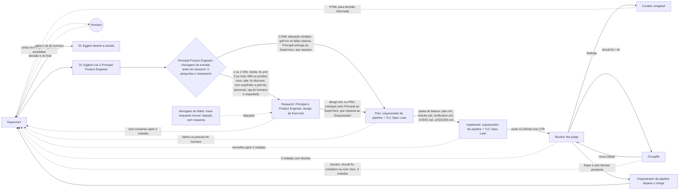

# Fábrica agêntica

Visão geral e regras da fábrica agêntica de software, no estado atual. Cada agente tem a sua ficha individual na pasta `modelos` (formato do Dr. Eggbot); este documento guarda o que é comum a todos: fluxo, regras, política de modelos, skills e ciclo de vida.

Dono do documento: Elienaldo Bittencourt. Redigido pelo Mestre de obras.

Legenda: itens marcados com **[proposta]** são sugestões minhas que o humano não pediu explicitamente. Confirme antes de tratar como regra.

---

## 1. Visão geral da fábrica agêntica

A fábrica recebe uma demanda e entrega código mergeado. Cada feature roda dentro de uma **sessão nomeada**, com a sua squad, criada e destruída pelo Dr. Eggbot.

### Fluxo, em fases

1. **Entrada:** fase sem diagrama próprio; descrita a partir das fichas do Supervisor e do Principal Product Engineer.
   - **Atores:** Supervisor (transversal e permanente), Dr. Eggbot e Principal Product Engineer; o humano só entra se faltar o projeto.
   - **Como acontece:** o Supervisor recebe a demanda (ticket, texto ou outra fonte). Só pergunta ao humano de qual projeto é a feature (nome ou caminho) se a demanda não trouxer. Cria a sessão nomeada em minúsculo, `feat/<nome-da-feature>` ou `fix/<nome-da-feature>`, e pede ao Dr. Eggbot o Principal Product Engineer, que sempre existe. Em seguida passa a feature ou a solicitação a ele. O Supervisor não classifica, não desenha, não implementa e não opina sobre o produto.
2. **Classificação:** é a porta de entrada do diagrama da fase research (`fase-research`).
   - **Atores:** Principal Product Engineer, que atua como guardião do escopo.
   - **Como acontece:** o Principal Product Engineer recebe o pedido de feature e o classifica com 5 perguntas (1. muda arquitetura? 2. afeta mais de um serviço, ou um componente de que muitos dependem? 3. tem ambiguidade de requisito? 4. é difícil de desfazer (muda dados persistidos, faz migração ou quebra contrato de API ou integração)? 5. toca autenticação, permissões, dados pessoais ou segredos?) Ele conta os SIM: nenhum SIM é simples (a feature é pequena: pula o research e entra no plan como solicitação direta); um ou dois SIM é média; três ou mais SIM, ou produto novo, é alta; média e alta vão para o research. SIM na pergunta 4 (difícil de desfazer) ou na 5 (segurança) dá no mínimo média. O humano pode definir o nível na própria solicitação com uma tag em linguagem natural (por exemplo, "aceite como média", "entenda como média", "utilize como alta"): com tag, o Principal respeita e não reavalia; sem tag, ele avalia sozinho com as 5 perguntas. Nessa mesma checagem de entrada, feita ao receber a demanda e **antes do research**, ele também decide quais skills opcionais entram, pela regra de roteamento da seção 2.10 (simples, média ou alta complexidade), e audita as skills do fluxo e instala as que faltarem, sem pedir permissão; isso vale para qualquer skill.
3. **Research** (só se a classificação mandar):
   - **Atores:** Principal Product Engineer e Product Engineer (produto e engenharia, mesmo peso de voto, modelos de famílias diferentes), design de front-end, advogado do diabo e, em caso de impasse, o humano.
   - **Como acontece:** o time de research discute a feature e cada membro toma uma posição. O Principal Product Engineer e o Product Engineer trazem o como técnico, cada um com a sua visão, e também cuidam do escopo e da prioridade; o design de front-end desenha a experiência do front. O advogado do diabo só levanta objeções enumeradas e justificadas, não vota e trava a fase enquanto houver objeção sem resposta. O time usa as skills que o Principal Product Engineer roteou (seção 2.10): tlc-prd (feature média; entrevista que gera o PRD), tlc-discover (alta complexidade ou produto novo; entrevista que gera o design doc), wayfinder (opcional na alta; mapa de decisões, só para início de projeto; quem avalia e decide é o Principal Product Engineer, e o humano é acionado se ele não conseguir decidir), grill-me (opcional na alta; perguntas duras) e prototype (protótipo descartável do designer quando há dúvida visual ou de interação). O research começa com o Supervisor solicitando ao Cursor uma nova sessão, com contexto limpo, a pedido do Principal Product Engineer (seção 2.2).
   - **Consenso:** as posições vão para a decisão da equipe em consenso: os engenheiros e o design de front-end decidem juntos sobre a solução sugerida; o advogado do diabo não vota. Sem consenso, abre nova rodada, no máximo 2. Sem consenso depois de 2 rodadas, o humano decide.
   - **Saída:** com o consenso, ou com a decisão humana, o passo de síntese gera o artefato de saída conforme o nível: na média, o **PRD**, escrito pela **tlc-prd** em `.prd/<slug>.md`; na alta, o **design doc**, escrito pela **tlc-discover** em `.design/<nome>.md` (problema, opções, decisão e trade-offs). O artefato segue para a fase plan. O Principal Product Engineer só orquestra: aciona a skill e não escreve o documento.
4. **Plan:**
   - **Atores:** Principal Product Engineer (entrega o insumo ao Supervisor), Supervisor (repassa o insumo ao Orquestrador e determina se é plan ou implement), Orquestrador de pipeline, modelo do Cursor (executa a skill TLC Spec Lean) e o humano, quando é avisado.
   - **Como acontece:** o Principal Product Engineer entrega ao **Supervisor** o design doc ou o PRD, vindos do research, ou a solicitação direta (texto, ticket do Notion ou do Jira, ou um ajuste), quando a feature pulou o research; nunca entrega direto ao Orquestrador. O Supervisor repassa o insumo ao Orquestrador e, conforme o insumo (planejamento ou implementação), determina se é plan ou implement; o Orquestrador acorda quando o Supervisor inicia a fase plan. Como o **Orquestrador de pipeline** já tem as regras dele, ao receber o insumo ele solicita de volta ao Supervisor que faça a solicitação ao Cursor: o caminho é um bate-volta, Principal → Supervisor → Orquestrador → Supervisor → Cursor. Não existe caminho direto do Principal ao Orquestrador. O Orquestrador pede ao Supervisor que solicite ao Cursor uma nova sessão com contexto limpo, passando todas as informações e o modelo (informado ou padrão), e que peça ao modelo que dispare a skill **TLC Spec Lean** em modo plan. Regra: sempre pedir o planejamento E os checks; senão a skill só gera o `plan.md`. A skill gera os artefatos na pasta da feature: `plan.md` (o que o humano lê e contesta), `checks.md` (obrigações com prova, base do implement), `verification.md` (reservado, escrito pela própria skill na verificação, depois do build), `STATE.md` (decisões do projeto) e `LESSONS.md` (gerado a partir de falhas, nunca à mão).
   - **Saída:** com a pasta pronta, o orquestrador checa o resultado. Se falhou ou precisa de humano, o orquestrador reporta ao Supervisor, que avisa o humano, e o humano decide. Se não, devolve o resultado ao Supervisor com o caminho da pasta da feature, que o Supervisor repassa ao Orquestrador como insumo de implementação (fase implement).
5. **Implement:**
   - **Atores:** Orquestrador de pipeline, modelo do Cursor (o menos custoso, executa a skill TLC Spec Lean) e o humano, que recebe a escalada.
   - **Como acontece:** o orquestrador de pipeline pede ao Supervisor que solicite ao Cursor uma nova sessão com contexto limpo e que peça ao modelo que dispare a skill **TLC Spec Lean** em modo implement, passando o projeto, a feature atual e o caminho da pasta da feature (com `plan.md`, `checks.md`, `verification.md`, `STATE.md` e `LESSONS.md`); o modelo é opcional. Dentro da skill, tudo roda local: o build executa o que foi planejado, os testes unitários rodam a partir dos checks do plan e, depois da implementação, a skill executa a verificação, uma subtarefa interna dela, que confere se está tudo verde. Regra: teste vermelho é parada, e a asserção nunca é enfraquecida.
   - **Correção:** se ficar vermelho, abre uma rodada de correção e volta para os testes, até 3 rodadas. Se ainda estiver vermelho depois de 3 rodadas, escala ao humano.
   - **Saída:** com tudo verde, a skill faz o handoff final ao orquestrador com o caminho da pasta da feature. O orquestrador então pede ao Supervisor que solicite ao modelo do Cursor um push no GitHub; o push gera o PR automaticamente e encerra a fase implement.
6. **Review:**
   - **Atores:** Orquestrador de pipeline, modelo do Cursor (executa a skill the-judge), Curador amigável, Cirurgião e o humano.
   - **Como acontece:** com o PR aberto, o orquestrador de pipeline pede ao Supervisor que solicite ao Cursor uma nova sessão, antes de passar qualquer informação, e passa projeto, feature e número do PR. Em seguida pede ao Supervisor que solicite ao modelo (padrão ou específico) que dispare a skill **the-judge** para efetuar um **review do PR**, passando o número do PR (`--pr <número>`) e o modelo. A the-judge classifica os findings em blocker, should fix e nit, faz no máximo 3 rodadas por execução, e cada nova rodada revisa só o diff novo.
   - **Curador amigável:** pega o resultado do review da skill the-judge e o transforma em um HTML visual e amigável, com linguagem direta e simples para qualquer senioridade de engenheiro, exibido no app do Grok Bot. Destaca os blockers e os itens não bloqueantes e, principalmente, o que precisa de decisão humana, para que a decisão seja informada. Não corrige, não reclassifica e não muda a severidade. Se o review vier limpo, não gera HTML.
   - **Cirurgião:** corrige sozinho os itens de should fix e nit, mexendo só no necessário, e devolve o PR para a the-judge revisar de novo. Should fix complexo ou com risco vai para o humano. Quando há **blocker**, o cirurgião nunca corrige por conta própria: solicita intervenção humana, e só corrige o blocker com autorização do humano (que pode trazer uma sugestão de correção); nesse caso a the-judge valida e, se passar, o merge é automático, sem nova avaliação humana. **Limite de loops:** no máximo 3 rodadas de correção; se estourar as 3 rodadas, ele obrigatoriamente para, trava e chama intervenção humana.
   - **Travas anti-loop:** 3 rodadas com blocker param e escalam ao humano; should fix 3 vezes seguidas depois do cirurgião trava; blocker novo sempre vai para o humano; should fix complexo ou com risco vai para o humano.
7. **Merge:** fase sem diagrama próprio; descrita a partir do bloco "Merge automático" do diagrama `fase-pr`.
   - **Atores:** Orquestrador de pipeline e, antes dele, a the-judge, que dá o veredito.
   - **Como acontece:** quando a última rodada da the-judge vem limpa e não há blocker pendente (nit pode ficar), o orquestrador de pipeline dispara o merge no GitHub. O PR mergeado é o handoff final da fábrica.
8. **Aviso:** o Supervisor avisa o humano no merge, pelo app do Grok Bot.

### Quem é quem

| Agente | Papel | Ficha |
| --- | --- | --- |
| Supervisor | Recebe a demanda, pergunta o projeto só se ela não trouxer, cria a sessão `feat/` ou `fix/`, pede ao Dr. Eggbot o Principal Product Engineer e coordena do pedido ao merge; transversal e permanente; único canal de comunicação com o humano: recebe as mensagens dos bots e repassa ao humano quando necessário; avisa o humano no merge pelo app do Grok Bot e, depois do ok final, pede ao Dr. Eggbot a destruição da sessão; recebe do Principal os insumos (design doc, PRD ou solicitação direta), repassa ao Orquestrador determinando se é plan ou implement e faz ao Cursor o pedido que o Orquestrador devolve a ele; toda comunicação entre atores passa por ele. Toda fase nova começa com ele solicitando ao Cursor uma sessão nova, com contexto limpo, e o handoff entre fases passa sempre por ele (seção 2.2). | `supervisor.md` |
| Dr. Eggbot | Cria e destrói os bots e os chats da sessão. | `dr-eggbot.md` |
| Principal Product Engineer | Entrada da feature na squad, guardião do escopo e engenheiro mais experiente; é acordado pelo Supervisor e sempre existe na sessão; faz a checagem de entrada, antes do research: respeita a tag de nível escrita pelo humano e, sem tag, classifica a feature com 5 perguntas e contagem de SIM (simples vai direto ao plan; média e alta vão ao research) e roteia as skills opcionais conforme a complexidade (seção 2.10); audita as skills do fluxo e instala as que faltarem; decide o uso opcional do grill-me e do wayfinder e, se não conseguir, aciona o humano; no research tem o mesmo peso de voto do Product Engineer e, junto com ele, decide o como técnico; entrega ao Supervisor (nunca direto ao Orquestrador) o design doc, o PRD ou a solicitação direta, e o Supervisor repassa ao Orquestrador. | `principal-product-engineer.md` |
| Product Engineer | Segundo engenheiro de produto, com o mesmo peso de voto do Principal Product Engineer; junto com ele, decide o como técnico no research. | `product-engineer.md` |
| Design de front-end | Especialista em front-end: decide a experiência (UX e UI), cria o protótipo descartável quando há dúvida visual ou de interação e fecha o consenso da área de design. | `design-front-end.md` |
| Advogado do diabo | Levanta objeções enumeradas e justificadas; não vota, não decide e não propõe solução; trava a fase enquanto houver objeção sem resposta. | `advogado-do-diabo.md` |
| Orquestrador de pipeline | Atua em plan, implement e review: recebe os insumos do Supervisor (nunca direto do Principal), que determina se é plan ou implement, e, como já tem as regras dele, devolve ao Supervisor o pedido ao Cursor; pede ao Supervisor (só ele dispara o Cursor) que solicite ao Cursor uma sessão nova com contexto limpo por fase, que peça ao modelo que dispare a TLC Spec Lean (plan e implement) e a the-judge (review do PR, com número do PR e modelo) e que peça o push que cria o PR; dispara o merge. Não abre sessão por conta própria: a sessão nova de cada fase é aberta pelo Supervisor a pedido dele (seção 2.2). | `orquestrador-de-pipeline.md` |
| Cirurgião | Corrige should fix e nit do PR e devolve à the-judge; escala should fix complexo; blocker só com autorização humana; máximo de 3 rodadas de correção, depois trava e escala ao humano. | `cirurgiao.md` |
| Curador amigável | Transforma os findings da the-judge em HTML amigável no app do Grok Bot, destacando o que precisa de decisão humana; não corrige nem muda severidade. | `curador-amigavel.md` |

---

## 2. Regras gerais

### 2.1 Sessão nomeada e ID por feature (paralelismo)

- Cada feature tem uma sessão cujo nome é o prefixo em minúsculo mais o nome da feature:
  - `feat/<nome-da-feature>` para feature nova.
  - `fix/<nome-da-feature>` para correção.
- O nome da feature em formato slug (minúsculas, hifens) é o **ID da feature**. Tudo da feature leva esse ID: sessão, pasta, branch, PR, nome dos agentes da squad.
- O ID separa o trabalho de features diferentes, então várias features rodam **em paralelo**, cada uma com a sua squad, sem compartilhar estado.
- Se o ID já existir ativo, o Dr. Eggbot recusa a criação e devolve ao Supervisor, em vez de reaproveitar a squad.
- Cada feature tem uma pasta própria; o caminho dela viaja junto com o design doc no handoff.

### 2.2 Toda fase nova começa com sessão nova, pedida ao Cursor pelo Supervisor

Toda fase nova (research, plan, implement e review) começa com o Supervisor solicitando ao Cursor que abra uma nova sessão, com contexto limpo, sem exceção. Vale para o início de cada fase, e o pedido é feito antes de passar qualquer informação. A abertura é sempre solicitada ao **Cursor**, nunca ao modelo, e só o **Supervisor** dispara o Cursor: nas fases plan, implement e review, ele faz o pedido que o Orquestrador de pipeline devolve a ele; na research, a pedido do Principal Product Engineer. O modelo entra como parâmetro da solicitação e só roda skills e executa ações.

**Handoff entre fases.** O handoff entre fases passa sempre pelo Supervisor, que dispara a sessão nova. A fase que termina devolve o resultado ao Supervisor; ele abre a sessão nova da fase seguinte e entrega a ela os insumos. Nenhuma fase reaproveita a sessão da anterior. Continuações dentro da mesma fase (rodada de correção, nova rodada da the-judge, ajuste pedido pelo humano) e o ambiente dev depois do merge, que continua a review e não é uma das quatro fases, seguem na sessão da própria fase.

### 2.3 Decisão da equipe em consenso

No research, a decisão é da equipe em consenso: os engenheiros (Principal Product Engineer e Product Engineer, mesmo peso de voto) e o design de front-end, que também é engenharia, decidem em consenso sobre a solução sugerida. O advogado do diabo não vota: só levanta pontos. A prioridade única dos engenheiros de produto é entregar valor ao usuário. Sem consenso depois de 2 rodadas, o humano desempata.

### 2.4 Advogado do diabo sem voto

O advogado do diabo **não vota**. Só levanta objeções, enumeradas e justificadas. A fase **não avança** enquanto houver objeção sem resposta registrada (ele trava a fase).

### 2.5 Design doc ou PRD como saída do research

A saída do research é o artefato do nível: na média, o **PRD**, gerado pela tlc-prd; na alta, o **design doc** (problema, opções, decisão e trade-offs), escrito pela tlc-discover. Ele é gerado no passo de síntese (o Principal Product Engineer só orquestra) e é o que o plan recebe (seção 2.10).

### 2.6 Classificação e atalho

O Principal Product Engineer faz 5 perguntas: a feature **muda arquitetura**? **Afeta mais de um serviço**, ou um componente de que muitos dependem? Tem **ambiguidade de requisito**? É **difícil de desfazer** (muda dados persistidos, faz migração ou quebra contrato de API ou integração)? **Toca segurança** (autenticação, permissões, dados pessoais ou segredos)? Ele conta os SIM: nenhum é simples e vai pelo atalho direto ao plan, sem research; um ou dois é média; três ou mais, ou produto novo, é alta; média e alta vão para o research. SIM na pergunta 4 (difícil de desfazer) ou na 5 (segurança) dá no mínimo média. Se o humano escreveu a tag de nível na solicitação, o Principal a respeita e não reavalia (seção 2.10).

### 2.7 Skills que faltam

O Principal Product Engineer audita as skills do fluxo. Se faltar alguma skill do fluxo, ele avisa e instala sem pedir permissão ao humano, porque a fábrica é automatizada e não pode parar por falta de skill. Isso vale para qualquer skill.

### 2.8 Limites de rodadas

- Implement: até 3 rodadas de correção na verificação; depois escala ao humano.
- the-judge: máximo de 3 rodadas de revisão por execução.
- Cirurgião: máximo de 3 rodadas de correção; depois trava e escala ao humano.

### 2.9 Regras para o humano

- **Blocker é sempre humano.** O cirurgião não corrige blocker sozinho; se o humano não intervir, o fluxo trava e escala.
- Should fix complexo ou com risco escala ao humano.
- Toda comunicação com o humano passa pelo Supervisor.
- O humano pode, opcionalmente, direcionar a forma de correção. Não é obrigatório.
- **Aviso ao humano com dono único.** O Supervisor é o dono da comunicação com o humano, pelo app do Grok Bot. O orquestrador de pipeline e os demais bots reportam ao Supervisor e não avisam o humano diretamente, para não haver mensagem duplicada. O Supervisor repassa só o necessário, com tom claro e direto: o que aconteceu e se há decisão pendente.

### 2.10 Roteamento de skills pelo Principal Product Engineer

Na **checagem de entrada**, feita ao receber a demanda e **antes do research** (não dentro dele), o Principal Product Engineer avalia a demanda e determina **quais skills opcionais serão usadas**, pela complexidade:

| Demanda | Skills | Artefato |
| --- | --- | --- |
| Alteração simples (0 SIM) | Nenhuma obrigatória; `grill-me` só se precisar de clareza. | Sem PRD e sem design doc: vai direto ao plan como solicitação direta. |
| Feature média (1 ou 2 SIM; ou SIM em difícil de desfazer ou segurança) | `tlc-prd` (entrevista). | PRD. |
| Alta complexidade (3 ou mais SIM) ou produto novo | `tlc-discover` (entrevista); `wayfinder` (só para início de projeto) e `grill-me` opcionais. | Design doc (tlc-discover) e, se usado, mapa de decisões (wayfinder). |

- **Contagem de SIM:** nenhum SIM é simples; um ou dois SIM é média; três ou mais SIM, ou produto novo, é alta. SIM na pergunta 4 (difícil de desfazer) ou na 5 (segurança) dá no mínimo média.
- **Tag do humano:** o humano pode definir o nível na própria solicitação, com uma tag em linguagem natural (por exemplo, "aceite como média", "entenda como média", "utilize como alta"). O humano decide o nível: com tag, o Principal Product Engineer a respeita, não reavalia e trata a demanda direto pelo nível indicado; sem tag, ele avalia sozinho com as 5 perguntas e conta os SIM.
- A `to-spec` fica **fora** da fábrica: é redundante com a `tlc-prd`.
- **[proposta]** Como isso se combina com a classificação da seção 2.6: a checagem de entrada é uma só; alteração simples é o caso em que as 5 perguntas dão NÃO (atalho ao plan); feature média e alta complexidade seguem pelo research, com a skill roteada. Confirme antes de tratar como regra.
- As skills roteadas entram na regra da seção 2.7: se faltar alguma, o Principal Product Engineer a instala sem pedir permissão.

---

## 3. Política de modelos de LLM

O modelo concreto de cada agente é escolha do humano e do Dr. Eggbot na hora de criar, conforme o que estiver disponível e o preço.

Regra dos dois engenheiros de produto (Principal Product Engineer e Product Engineer): **modelos de famílias diferentes**, para que a discussão não seja a mesma opinião duas vezes.

---

## 4. Skills

Skills não são agentes: são instruções que um agente carrega. Não há criação ou destruição de skill por feature.

### 4.1 the-judge

- **O que é:** skill de **review de PR**.
- **Quem usa:** o modelo, solicitado pelo Supervisor a pedido do orquestrador de pipeline na fase de review, em sessão nova do Cursor.
- **Como funciona:** até **3 rodadas** por execução; classifica cada finding em **blocker**, **should fix** ou **nit**. Nova rodada, depois de uma correção, só revisa o diff novo.
- **Saída:** findings, entregues ao curador amigável e ao cirurgião.
- **Observação:** o texto original da skill vem do humano; este documento só a descreve.

### 4.2 TLC Spec Lean

- **O que é:** skill de especificação e execução (nome real: `tlc-spec-lean`).
- **Usos na fábrica:**
  - **Plan:** gera na pasta da feature `plan.md` e `checks.md` (sempre pedir planejamento E checks), além de `verification.md` (reservado), `STATE.md` e `LESSONS.md`.
  - **Implement:** executa o que foi planejado. Os commits, os gates e a verificação são internos da skill. O `verification.md` é gerado pela própria skill, pelo Verifier, um subagente interno dela que nunca é o autor do código; não há fase nem agente separado para isso.
- **Quem usa:** o modelo do Cursor, disparado pelo Supervisor a pedido do orquestrador de pipeline, com o modelo da fase.

### 4.3 grill-me

- **O que é:** skill de **questionamentos**.
- **Quem usa:** o time de research; pode ser usada em qualquer projeto. Na alteração simples (sem research), é usada só se precisar de clareza, antes do plan (seção 2.10).

### 4.4 wayfinder

- **O que é:** skill de mapa de decisões; usada **só para início de projeto** (produto novo ou alta complexidade), como opcional ao lado da tlc-discover; convive com o grill-me, também opcional na alta, e um não substitui o outro.
- **Quem decide:** o Principal Product Engineer avalia se usa o grill-me, o wayfinder ou os dois; se ele não conseguir decidir, o humano é acionado.
- **Instalação:** como qualquer skill do fluxo, é instalada sem pedir permissão quando falta.

### 4.5 prototype

- **O que é:** skill do **designer** para **protótipo descartável**, que nunca vira código de produção.
- **Quando usa:** dúvida visual ou de interação: feature nova, mudança grande de front-end ou pedido do humano.

### 4.6 tlc-discover

- **O que é:** skill do Tech Leads Club que conduz uma **entrevista** sobre uma ideia sem forma e gera um **design document**, em `.design/<nome>.md` (situação, problema, sucesso, fronteira, forma, decisões-chave e trabalho em fatias).
- **Quando usa:** alta complexidade ou produto novo (seção 2.10).
- **Quem usa:** o time de research, roteado pelo Principal Product Engineer.
- **Observação:** se o risco for baixo, ela responde num parágrafo e não gera arquivo.

### 4.7 tlc-prd

- **O que é:** skill do Tech Leads Club que conduz uma **entrevista** e gera um **PRD**, em `.prd/<slug>.md` (situação, problema, sucesso, fronteira e tabela de journey). Para antes de qualquer design técnico.
- **Quando usa:** feature média (seção 2.10).
- **Quem usa:** o time de research, roteado pelo Principal Product Engineer.
- **to-spec:** fora da fábrica, por ser redundante com a tlc-prd.

---

## 5. Ciclo de vida da squad

| Momento | Quem faz | O quê |
| --- | --- | --- |
| Demanda chega | Supervisor | Recebe a demanda, abre a sessão `feat/<feature>` ou `fix/<feature>` e pede ao Dr. Eggbot o Principal Product Engineer. |
| Criação | Dr. Eggbot | Cria os agentes com o ID da feature. O Principal Product Engineer, o orquestrador de pipeline, o cirurgião e o curador amigável existem em toda sessão; o time de research só quando a classificação mandar. |
| Execução | Orquestrador de pipeline e squad | O orquestrador atua só dentro das fases plan, implement e review: pede ao Supervisor que solicite ao Cursor a abertura das sessões e dispare as skills (só o Supervisor dispara o Cursor). O Supervisor continua transversal e permanente. |
| Merge | Orquestrador de pipeline | Dispara o merge no GitHub quando a última rodada da the-judge vem limpa e não há blocker pendente. |
| Aviso | Supervisor | Avisa o humano no merge. |
| Destruição | Dr. Eggbot, a pedido do Supervisor | Depois do ok do humano sobre a finalização, destrói os bots e os chats exclusivos da sessão. Supervisor e Dr. Eggbot continuam. |
| Cancelamento | Supervisor, a pedido do humano **[proposta]** | Dr. Eggbot destrói a sessão sem merge. |

Decisões do Dr. Eggbot:

- **Criação dos agentes de research:** o Dr. Eggbot cria os agentes de research somente quando o Principal Product Engineer classificar a feature como SIM. Se a feature pega o atalho, eles não são criados.
- **Destruição:** o Dr. Eggbot destrói a sessão quando decidido, depois do ok do humano sobre a finalização, recebido pelo Supervisor.
