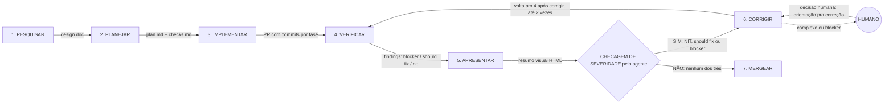

# Contrato de execução e verificação

Registro em texto do diagrama `fluxo-contrato-verificacao.excalidraw` (a versão anterior está em `fluxo-contrato-verificacao-anterior.excalidraw`). Só ações, sem nomes de agentes. Link: https://excalidraw.com/#json=FeBJ8Pkzd6kl2NfbplB6U,hxGrFlM0ZSAoBqsQ5X0Ceg (anterior à correção do quadro 7; o link novo está pendente)

Limite de rodadas: no máximo 3 no total (1 vinda do quadro 3 + até 2 saindo do quadro 6 de volta ao 4). NIT continua sendo corrigido pelo agente, sem humano. Nenhuma saída do humano vai direto ao merge.

| Passo | Ação | Artefato que sai |
| --- | --- | --- |
| 1. Pesquisar | Brainstorm em grupo; objeções levantadas; consenso por área. | design doc |
| 2. Planejar | Gera plan.md e checks.md com critérios de pronto. | plan.md + checks.md |
| 3. Implementar | Executa por fases; commit automático por fase; gates de verificação. | PR com commits por fase |
| 4. Verificar | Revisa o PR e classifica em blocker, should fix e nit; máx. 3 rodadas no total. | findings |
| 5. Apresentar | Findings viram visualização amigável e direta. | resumo visual (HTML) |
| Checagem | O agente confere se há NIT, should fix ou blocker: se sim vai pro 6, se não vai direto pro 7. | decisão de rota |
| 6. Corrigir | Corrige should fix e nit sozinho; complexo sobe pro humano; blocker é sempre humano. O humano devolve decisão com orientação pra correção. | nova rodada de verificação |
| 7. Mergear | Automático se limpo; nada do humano vai direto ao merge; correção volta pelo ciclo 6, 4 e 5. | merge |
