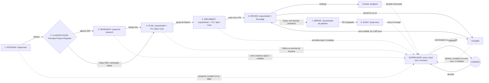

# Contrato de execução e verificação

Registro em texto do diagrama `fluxo-contrato-verificacao.excalidraw`, versão de 01/11/2026, alinhada às 8 fases do documento `fábrica-agêntica.md` (a versão anterior está em `fluxo-contrato-verificacao-anterior.excalidraw`). Link: https://excalidraw.com/#json=FeBJ8Pkzd6kl2NfbplB6U,hxGrFlM0ZSAoBqsQ5X0Ceg (anterior aos diagramas de 01/11; o link novo está pendente)

Limites de rodadas, contados separadamente: research 2; implement 3; the-judge 3 por execução; Cirurgião 3. Merge: última rodada da the-judge limpa e sem blocker pendente (nit pode ficar). O humano só fala pelo Supervisor.

| Fase | Quem faz | Ação | Artefato que sai |
| --- | --- | --- | --- |
| 1. Entrada | Supervisor e Dr. Eggbot | Recebe a demanda, cria a sessão `feat/` ou `fix/`; o Dr. Eggbot cria o Principal Product Engineer. | feature |
| 2. Classificação | Principal Product Engineer | 3 perguntas; audita e instala as skills. Alguma SIM vai ao research; todas NÃO vão direto ao plan. | rota |
| 3. Research | Principal e Product Engineer, design de front-end, advogado do diabo (sem voto) | Consenso por área, máx. 2 rodadas. | design doc |
| 4. Plan | Orquestrador de pipeline + TLC Spec Lean | Gera plan.md, checks.md, verification.md (reservado), STATE.md e LESSONS.md. | pasta da feature |
| 5. Implement | Orquestrador de pipeline + TLC Spec Lean | Build, testes e verificação internos da skill (Verifier e commits internos); máx. 3 rodadas; push cria o PR. | PR |
| 6. Review | Orquestrador de pipeline + the-judge; Curador amigável; Cirurgião | the-judge classifica em blocker, should fix e nit (máx. 3 rodadas por execução); o Curador gera o HTML; o Cirurgião corrige should fix e nit (máx. 3 rodadas), blocker só com autorização. | findings, HTML |
| 7. Merge | Orquestrador de pipeline | Dispara o merge no GitHub quando limpo e sem blocker pendente. | PR mergeado |
| 8. Aviso | Supervisor | Avisa o humano no merge; após o ok, o Dr. Eggbot destrói a sessão. | aviso |
