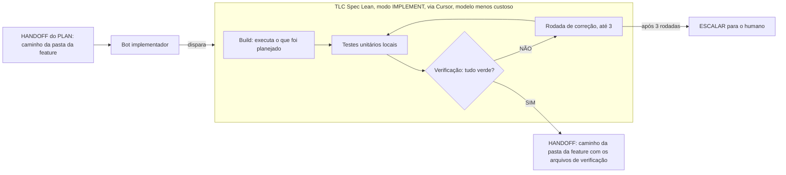

# Fábrica agêntica - Fase IMPLEMENT

Registro em texto do diagrama `fase-implement.excalidraw`. Entra depois do handoff da fase PLAN.

## Peças

| Peça | O que faz |
| --- | --- |
| HANDOFF do PLAN | Entrega o caminho da pasta da feature (com `plan.md` e `checks.md`). |
| Bot implementador | Só dispara a skill. Não escreve código. |
| TLC Spec Lean (modo implement) | Disparada via Cursor, escolhendo o modelo menos custoso. Recebe o caminho da pasta da feature e executa o que foi planejado. |
| Build | A skill executa o que foi planejado. |
| Testes unitários | Rodam localmente, a partir dos checks do plan. |
| Verificação | Confere se tudo está verde. |
| Rodada de correção | Até 3 rodadas, voltando a testar. |
| Escalar | Depois de 3 rodadas sem ficar verde, escala para o humano. |
| Regra | Teste vermelho é parada. Não se enfraquece a asserção. |
| Handoff final | Caminho da pasta da feature com os arquivos de verificação. |

## Nota

A skill real é `tlc-spec-lean`. "Escalar para o humano" é a leitura do desenho de "escalar"; o destino exato não foi definido por você.
