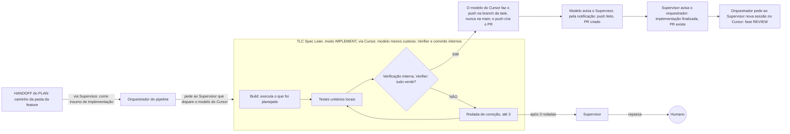

# Fábrica agêntica - Fase IMPLEMENT

Registro em texto do diagrama `fase-implement.excalidraw`. Entra depois do handoff da fase PLAN.

## Peças

| Peça | O que faz |
| --- | --- |
| HANDOFF do PLAN | Entrega o caminho da pasta da feature (com `plan.md` e `checks.md`). |
| Orquestrador de pipeline | Pede ao Supervisor que solicite ao modelo do Cursor que dispare a skill (só o Supervisor dispara o Cursor). Não escreve código. |
| TLC Spec Lean (modo implement) | Disparada via Cursor, escolhendo o modelo menos custoso. Recebe o caminho da pasta da feature e executa o que foi planejado. |
| Build | A skill executa o que foi planejado. |
| Testes unitários | Rodam localmente, a partir dos checks do plan. |
| Verificação | Subtarefa interna da skill (Verifier, parte da TLC Spec Lean, não é fase nem agente): confere se tudo está verde e gera o `verification.md`. Os commits também são internos da skill. |
| Rodada de correção | Até 3 rodadas, voltando a testar. |
| Escalar | Depois de 3 rodadas sem ficar verde, escala ao Supervisor, que repassa ao humano. |
| Regra | Teste vermelho é parada. Não se enfraquece a asserção. |
| Handoff final | Com a verificação ok, o modelo do Cursor faz o push na branch da task (nunca na main) e o push cria o PR. O modelo avisa o Supervisor pela notificação, o Supervisor avisa o orquestrador que a implementação terminou e que o PR existe, e o orquestrador pede ao Supervisor uma nova sessão para a fase REVIEW. Se a verificação falhar, não há push. Detalhe em `orquestrador-de-pipeline.md` e `comunicacao-bidirecional-cursor.md`. |

## Nota

A skill real é `tlc-spec-lean`. A escalada vai ao Supervisor, único canal com o humano.

Decidido em 2026-11-05: toda fase nova (research, plan, implement e review) começa com o Supervisor solicitando ao Cursor que abra uma nova sessão, com contexto limpo, sem exceção. A implement começa com o Supervisor abrindo a sessão nova, e a review também (já descrito acima). O handoff entre fases passa sempre pelo Supervisor, que dispara a sessão nova.
