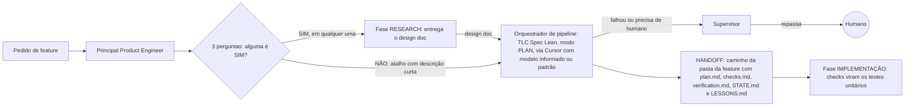

# Fábrica agêntica - Fase PLAN

Registro em texto do diagrama `fase-plan.excalidraw` (versão 2, escala maior e espaçamento aberto, mesmo conteúdo da primeira). Esta fase fica entre o pedido de feature (ou a fase RESEARCH) e a fase IMPLEMENTAÇÃO.

## Peças

| Peça | O que faz |
| --- | --- |
| Pedido de feature | Entrada da fase. |
| Principal Product Engineer | Classifica o pedido (feature pequena ou precisa de research) e entrega ao orquestrador o design doc ou a solicitação direta. |
| 3 perguntas | 1. Muda a arquitetura? 2. Mexe em mais de um serviço? 3. Tem ambiguidade de requisito? Se alguma resposta for SIM, vai para o research. Se todas forem NÃO, vai direto para o plan com a descrição curta (atalho). |
| Fase RESEARCH | Entrega o design doc que alimenta o plan. |
| TLC Spec Lean (modo plan) | O orquestrador de pipeline pede ao Cursor uma sessão nova e ao modelo (informado ou padrão) que dispare a skill. Recebe o design doc do research ou a descrição curta do atalho. Gera `plan.md`, `checks.md`, `verification.md` (reservado, gerado pela própria skill depois do build, pelo Verifier interno), `STATE.md` e `LESSONS.md` dentro da pasta da feature. Não cria tasks. |
| Handoff | Caminho da pasta da feature com os 5 arquivos. Se falhou ou precisa de humano, o orquestrador reporta ao Supervisor, que avisa o humano. |
| Fase IMPLEMENTAÇÃO | Os checks viram os testes unitários da implementação. |

## Nota

A skill foi citada por voz como "TLC Spec Liam"; o nome real da skill é `tlc-spec-lean`. A versão anterior (escala menor) ficou em `fase-plan-v1.excalidraw` e `fase-plan-v1.md`.
