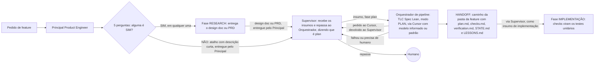

# Fábrica agêntica - Fase PLAN

Registro em texto do diagrama `fase-plan.excalidraw` (versão 2, escala maior e espaçamento aberto, mesmo conteúdo da primeira). Esta fase fica entre o pedido de feature (ou a fase RESEARCH) e a fase IMPLEMENTAÇÃO.

## Peças

| Peça | O que faz |
| --- | --- |
| Pedido de feature | Entrada da fase. |
| Principal Product Engineer | Classifica o pedido (feature pequena ou precisa de research) e entrega ao Supervisor o design doc, o PRD ou a solicitação direta (nunca direto ao Orquestrador). |
| Supervisor | Recebe os insumos do Principal e os repassa ao Orquestrador, determinando se é plan ou implement conforme o insumo. Inicia a fase plan, e é isso que acorda o Orquestrador. Faz ao Cursor o pedido que o Orquestrador devolve a ele. |
| 5 perguntas | 1. Muda a arquitetura? 2. Afeta mais de um serviço, ou um componente de que muitos dependem? 3. Tem ambiguidade de requisito? 4. É difícil de desfazer (muda dados persistidos, faz migração ou quebra contrato de API ou integração)? 5. Toca autenticação, permissões, dados pessoais ou segredos? Zero SIM é simples e vai direto para o plan com a descrição curta (atalho). Um ou dois SIM é média e três ou mais SIM é alta; as duas vão para o research. SIM na 4 ou na 5 dá no mínimo média. |
| Fase RESEARCH | Entrega o design doc que alimenta o plan. |
| TLC Spec Lean (modo plan) | O orquestrador de pipeline, que já tem as regras dele, ao receber os insumos do Supervisor pede de volta ao Supervisor que solicite ao Cursor uma sessão nova e ao modelo (informado ou padrão) que dispare a skill. Recebe o design doc do research ou a descrição curta do atalho. Gera `plan.md`, `checks.md`, `verification.md` (reservado, gerado pela própria skill depois do build, pelo Verifier interno), `STATE.md` e `LESSONS.md` dentro da pasta da feature. Não cria tasks. |
| Handoff | Caminho da pasta da feature com os 5 arquivos. Se falhou ou precisa de humano, o orquestrador reporta ao Supervisor, que avisa o humano. Se deu certo, o orquestrador devolve o resultado ao Supervisor, que repassa a pasta como insumo de implementação. |
| Fase IMPLEMENTAÇÃO | Os checks viram os testes unitários da implementação. |

## Nota

A skill foi citada por voz como "TLC Spec Liam"; o nome real da skill é `tlc-spec-lean`. A versão anterior (escala menor) ficou em `fase-plan-v1.excalidraw` e `fase-plan-v1.md`.

Decidido em 2026-11-05: toda comunicação entre atores passa pelo Supervisor (Principal → Supervisor → Orquestrador → Supervisor → Cursor). Não existe caminho direto do Principal ao Orquestrador.
