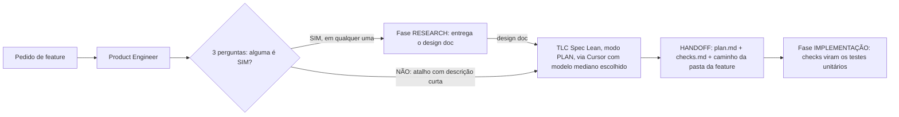

# Fábrica agêntica - Fase PLAN

Registro em texto do diagrama `fase-plan.excalidraw` (versão 2, escala maior e espaçamento aberto, mesmo conteúdo da primeira). Esta fase fica entre o pedido de feature (ou a fase RESEARCH) e a fase IMPLEMENTAÇÃO.

## Peças

| Peça | O que faz |
| --- | --- |
| Pedido de feature | Entrada da fase. |
| Product Engineer | Mesmo bot que classifica o pedido: feature pequena ou precisa de research. |
| 3 perguntas | 1. Muda a arquitetura? 2. Mexe em mais de um serviço? 3. Tem ambiguidade de requisito? Se alguma resposta for SIM, vai para o research. Se todas forem NÃO, vai direto para o plan com a descrição curta (atalho). |
| Fase RESEARCH | Entrega o design doc que alimenta o plan. |
| TLC Spec Lean (modo plan) | Disparada via Cursor com modelo mediano escolhido. Recebe o design doc do research ou a descrição curta do atalho. Gera `plan.md` e `checks.md` dentro da pasta da feature. Não cria tasks. |
| Handoff | `plan.md` + `checks.md` + caminho da pasta da feature. |
| Fase IMPLEMENTAÇÃO | Os checks viram os testes unitários da implementação. |

## Nota

A skill foi citada por voz como "TLC Spec Liam"; o nome real da skill é `tlc-spec-lean`. A versão anterior (escala menor) ficou em `fase-plan-v1.excalidraw` e `fase-plan-v1.md`.
