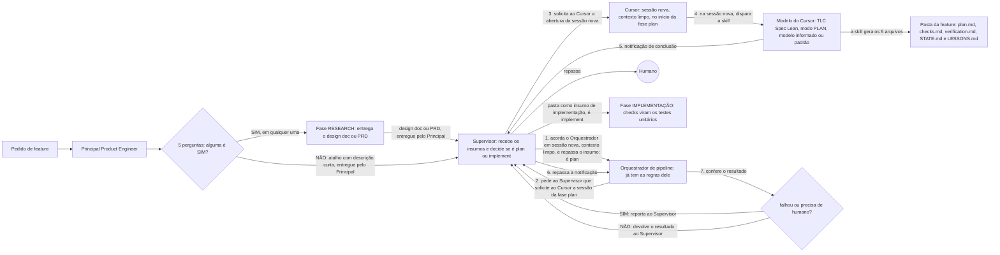

# Fábrica agêntica - Fase PLAN

Registro em texto do diagrama `fase-plan.excalidraw` (versão de 2026-11-05: Supervisor no meio de toda comunicação, sessão nova no início da fase e retorno da notificação). Esta fase fica entre o pedido de feature (ou a fase RESEARCH) e a fase IMPLEMENTAÇÃO.

## Peças

| Peça | O que faz |
| --- | --- |
| Pedido de feature | Entrada da fase. |
| Principal Product Engineer | Classifica o pedido (feature pequena ou precisa de research) e entrega ao Supervisor o design doc, o PRD ou a solicitação direta (nunca direto ao Orquestrador). |
| Supervisor | Recebe os insumos do Principal e decide se é plan ou implement conforme o insumo. Acorda o Orquestrador numa sessão nova, com contexto limpo, e repassa o insumo dizendo qual é a fase. Quando o Orquestrador pede, solicita ao Cursor a abertura da sessão nova da fase plan. Recebe do modelo a notificação de conclusão e a repassa ao Orquestrador. É o único canal com o humano. |
| 5 perguntas | 1. Muda a arquitetura? 2. Afeta mais de um serviço, ou um componente de que muitos dependem? 3. Tem ambiguidade de requisito? 4. É difícil de desfazer (muda dados persistidos, faz migração ou quebra contrato de API ou integração)? 5. Toca autenticação, permissões, dados pessoais ou segredos? Zero SIM é simples e vai direto para o plan com a descrição curta (atalho). Um ou dois SIM é média e três ou mais SIM é alta; as duas vão para o research. SIM na 4 ou na 5 dá no mínimo média. |
| Fase RESEARCH | Entrega o design doc que alimenta o plan. |
| TLC Spec Lean (modo plan) | O Orquestrador de pipeline, que já tem as regras dele, é acordado pelo Supervisor numa sessão nova e pede a ele que solicite ao Cursor a sessão da fase plan. O Supervisor abre a sessão nova, com contexto limpo, e nela o modelo (informado ou padrão) dispara a skill. Recebe o design doc ou PRD do research, ou a descrição curta do atalho. Gera `plan.md`, `checks.md`, `verification.md` (reservado, gerado pela própria skill depois do build, pelo Verifier interno), `STATE.md` e `LESSONS.md` dentro da pasta da feature. Não cria tasks. |
| Handoff | Ao concluir, o modelo notifica o Supervisor, que repassa a notificação ao Orquestrador. O Orquestrador confere o resultado. Se falhou ou precisa de humano, reporta ao Supervisor, que avisa o humano. Se deu certo, devolve o resultado ao Supervisor com o caminho da pasta da feature (os 5 arquivos), e o Supervisor repassa a pasta como insumo de implementação, abrindo a sessão nova da fase implement. |
| Fase IMPLEMENTAÇÃO | Os checks viram os testes unitários da implementação. |

## Nota

A skill foi citada por voz como "TLC Spec Liam"; o nome real da skill é `tlc-spec-lean`. A versão anterior (escala menor) ficou em `fase-plan-v1.excalidraw` e `fase-plan-v1.md`; a de antes desta reorganização, em `fase-plan-anterior-0511p.excalidraw`.

Decidido em 2026-11-05: toda comunicação entre atores passa pelo Supervisor (Principal → Supervisor → Orquestrador → Supervisor → Cursor). Não existe caminho direto do Principal ao Orquestrador.

Decidido em 2026-11-05: toda fase nova (research, plan, implement e review) começa com o Supervisor solicitando ao Cursor que abra uma nova sessão, com contexto limpo, sem exceção. No plan, o Supervisor abre a sessão nova e só então passa as informações. O handoff entre fases passa sempre pelo Supervisor, que dispara a sessão nova.

Corrigido em 2026-11-05 no diagrama: média usa `tlc-prd` e alta usa `tlc-discover` (a versão anterior do diagrama tinha as duas invertidas).
