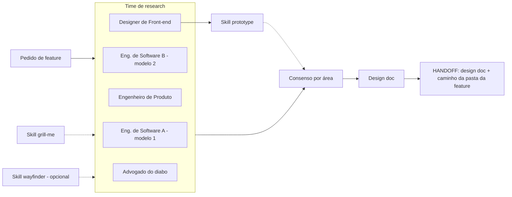

# Fábrica agêntica - Fase RESEARCH

> Versão antiga, substituída por `fase-research.md` e mantida como histórico: tem Eng. de Software A/B, Engenheiro de Produto e wayfinder com ok do humano, que não valem mais.

Registro em texto do diagrama antigo (o diagrama atual é `fase-research.excalidraw`). Entra quando alguma das 3 perguntas da fase PLAN dá SIM.

## Peças

| Peça | O que faz |
| --- | --- |
| Engenheiro de Software A | Pensa o como técnico, com um modelo diferente do B. |
| Engenheiro de Software B | Pensa o como técnico, com modelo diferente do A, para dar diversidade de pensamento. |
| Engenheiro de Produto | Decide escopo e prioridade. |
| Designer de Front-end | Decide o front. Usa a skill prototype quando há dúvida visual ou de interação. |
| Advogado do diabo | Só levanta objeções. Não vota. |
| Skill prototype | Gera protótipo descartável. Sempre em feature nova ou mudança grande de front-end, ou quando o humano pedir. |
| Skill grill-me | Questionamentos, usada em todo projeto. |
| Skill wayfinder | Para projeto do zero ou complexo. Opcional, instalada só se o humano aprovar. |
| Consenso por área | Engenheiros decidem o como técnico, produto decide escopo e prioridade, design decide o front. |
| Design doc | Saída padrão, com problema, opções, decisão e trade-offs. |
| Handoff | Design doc + caminho da pasta da feature. |
