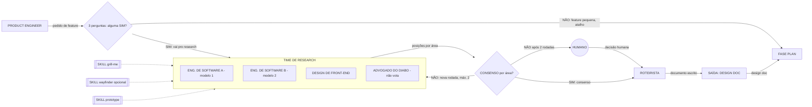

# Fábrica agêntica - Fase RESEARCH (v2, fundo preto)

Arquivo: `fase-research-v2.excalidraw`. Link: https://excalidraw.com/#json=rkxT364u6o0qaDD5niw6_,_otW52o-7OxLAZqe8bFtLA (versão atual; a anterior ao ajuste de tamanho e cor está em `fase-research-v2-anterior.excalidraw`)

| Peça | Forma | O que faz |
| --- | --- | --- |
| Product engineer | caixa | Recebe o pedido e classifica a feature com 3 perguntas. |
| 3 perguntas | losango | Muda arquitetura? Mexe em mais de um serviço? Requisito ambíguo? Qualquer SIM vai pro research. |
| Eng. de Software A e B | caixa | Dois engenheiros com modelos diferentes; decidem o como técnico. |
| Design de front-end | caixa | Desenha a experiência e decide o front. |
| Advogado do diabo | caixa | Só levanta objeções; não vota. |
| Skills grill-me, wayfinder (opcional), prototype | caixa tracejada de cantos retos | Perguntas duras; mapa de projeto grande; protótipo descartável. |
| Consenso por área | losango | Engenharia decide o técnico, produto o escopo, design o front. |
| Humano | círculo | Decide quando não há consenso após 2 rodadas. |
| Roteirista | caixa | Consolida as posições e escreve o design doc. |
| Design doc | caixa | Saída: problema, opções, decisão e trade-offs. |
| Fase PLAN | caixa | Recebe o design doc (quando a feature passou pelo research) ou a solicitação direta (quando é pequena e pula o research). |

Itens que eu propus e você não pediu: limite de 2 rodadas e o humano no desempate.
