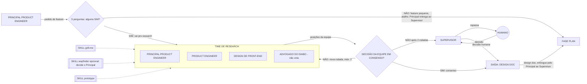

# Fábrica agêntica - Fase RESEARCH (fundo preto)

Arquivo: `fase-research.excalidraw`. Link: https://excalidraw.com/#json=rkxT364u6o0qaDD5niw6_,_otW52o-7OxLAZqe8bFtLA (anterior aos diagramas de 01/11; a anterior ao ajuste de tamanho e cor está em `fase-research-v2-anterior.excalidraw`)

| Peça | Forma | O que faz |
| --- | --- | --- |
| Principal Product Engineer | caixa | Recebe o pedido e classifica a feature com 5 perguntas. |
| 5 perguntas | losango | Muda arquitetura? Afeta mais de um serviço, ou um componente de que muitos dependem? Requisito ambíguo? É difícil de desfazer? Toca segurança? Qualquer SIM vai pro research (um ou dois é média; três ou mais é alta); SIM em difícil de desfazer ou em segurança dá no mínimo média. |
| Principal Product Engineer e Product Engineer | caixa | Mesmo peso de voto, modelos de famílias diferentes; decidem escopo, prioridade e o como técnico. |
| Design de front-end | caixa | Desenha a experiência e decide o front. |
| Advogado do diabo | caixa | Só levanta objeções; não vota. |
| Skills grill-me, wayfinder (opcional), prototype | caixa tracejada de cantos retos | Perguntas duras; mapa de projeto muito grande (decide o Principal; humano só se ele não conseguir, via Supervisor); protótipo descartável. |
| Decisão da equipe em consenso | losango | Os engenheiros e o design de front-end decidem em consenso sobre a solução sugerida. O advogado do diabo não vota, só levanta pontos. |
| Supervisor | caixa | Único canal com o humano; recebe a escalada e repassa a decisão. |
| Humano | círculo | Decide quando não há consenso após 2 rodadas, via Supervisor. |
| Design doc | caixa | Saída: problema, opções, decisão e trade-offs. |
| Fase PLAN | caixa | Recebe o design doc (quando a feature passou pelo research) ou a solicitação direta (quando é pequena e pula o research). |

Decidido em 2026-11-05: toda fase nova (research, plan, implement e review) começa com o Supervisor solicitando ao Cursor que abra uma nova sessão, com contexto limpo, sem exceção. O research começa com o Supervisor abrindo a sessão nova no Cursor, a pedido do Principal. O handoff entre fases passa sempre pelo Supervisor, que dispara a sessão nova.

Itens que eu propus e você não pediu: limite de 2 rodadas e o humano no desempate.

## Correção decidida pelo Elienaldo em 2026-11-06: entrevista e protótipo bloqueiam o avanço

- Quando grill-me ou tlc-discover produzir pergunta para o humano, o modelo do Cursor DEVE PARAR antes de brainstorm, consenso, protótipo ou design doc. Não responde pelo humano, não converte pergunta em recomendação aceita e não fecha rodada.
- O modelo devolve as perguntas ao Supervisor e informa explicitamente que o research está BLOQUEADO AGUARDANDO ENTREVISTA DO HUMANO. Só o Supervisor apresenta as perguntas ao Elienaldo e devolve as respostas ao Cursor.
- Só depois de receber as respostas do humano pelo Supervisor o modelo retoma o research e permite a criação da equipe para brainstorm e consenso. Ausência de resposta humana não é consenso.
- Ao receber o protótipo do research, o Supervisor o apresenta ao Elienaldo e NÃO inicia plan nem solicita o Orquestrador até um OK explícito dele. Consenso da equipe não substitui a validação humana do protótipo.
- Critério de pronto da entrevista: perguntas e respostas humanas registradas; sem isso, o research está em espera, não concluído.

