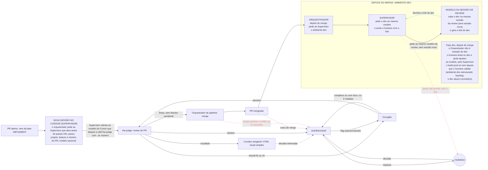

# Fábrica agêntica - Fase REVIEW

Registro em texto do diagrama `fase-review.excalidraw`. Entra depois do handoff da fase IMPLEMENT e termina com o PR mergeado.

## Peças

| Peça | O que faz |
| --- | --- |
| the-judge | Review de PR. Classifica findings em blocker, should fix e nit. No máximo 3 rodadas por execução. Se estourar 3 rodadas com blocker, para e escala pro humano. Nova rodada, depois de uma correção, só revisa o diff novo. |
| Curador amigável | Pega o resultado da the-judge e gera um HTML visual, com linguagem direta e simples, para facilitar a decisão de dev júnior, pleno ou novo no projeto. O HTML é visto no app do Grok Bot. Blockers e itens não bloqueantes (should fix e nit) ficam em destaque. |
| Cirurgião (agente, não skill) | Corrige should fix e nit sozinho. Should fix complexo ou com risco de efeito colateral vai pro humano, via Supervisor. Blocker nunca é corrigido sem flag de autorização humana. Depois de corrigir, devolve pra the-judge. No máximo 3 rodadas de correção; depois trava e escala. |
| Orquestrador de pipeline (merge) | Dispara o merge no GitHub só se não houver blocker pendente e o veredito da última rodada da the-judge passou limpo. Nit pode permanecer. Se o cirurgião usou flag de blocker autorizado e a the-judge validou, o merge é automático, sem nova avaliação humana. |
| Supervisor | Único canal com o humano: recebe as escaladas, repassa as decisões e avisa o humano no merge. |
| Humano | Fala só pelo Supervisor. Decide blocker, should fix complexo ou com risco e as travas anti-loop. Autoriza correção de blocker com flag. |
| PR mergeado | Handoff final da fábrica. |

## Travas anti-loop e escalada

- 3 rodadas da the-judge com blocker: para e escala pro humano, via Supervisor.
- Cirurgião: no máximo 3 rodadas de correção; depois trava e escala.
- Should fix gerado 3 vezes seguidas após correções do cirurgião: trava para intervenção humana.
- Blocker novo: sempre vai pro humano.
- Should fix complexo ou com risco de efeito colateral: humano.
- Blocker com decisão humana que inclui sugestão de correção: o cirurgião corrige com a flag, a the-judge valida, e se passou o merge é automático, sem nova avaliação humana.

## Sessão da review

Decidido em 2026-11-05: a review começa com o Supervisor solicitando ao Cursor uma nova sessão, com contexto limpo, sem exceção, a pedido do Orquestrador e antes de passar qualquer informação. O handoff entre fases passa sempre pelo Supervisor, que dispara a sessão nova. As rodadas da the-judge e do Cirurgião seguem na sessão da review.
