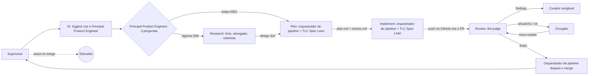

# Fábrica agêntica

Visão geral e regras da fábrica agêntica de software, no estado atual. Cada agente tem a sua ficha individual na pasta `modelos` (formato do Dr. Eggbot); este documento guarda o que é comum a todos: fluxo, regras, política de modelos, skills, ciclo de vida e pontos de atenção.

Dono do documento: Elienaldo Bittencourt. Redigido pelo Mestre de obras.

Legenda: itens marcados com **[proposta]** são sugestões minhas que o Elienaldo não pediu explicitamente. Confirme antes de tratar como regra.

---

## 1. Visão geral da fábrica agêntica

A fábrica recebe uma demanda e entrega código mergeado. Cada feature roda dentro de uma **sessão nomeada**, com a sua squad, criada e destruída pelo Dr. Eggbot.

### Fluxo, em fases

1. **Entrada:** o **Supervisor** (transversal e permanente) recebe a demanda, pergunta o projeto só se a demanda não trouxer, cria a sessão `feat/` ou `fix/` e pede ao Dr. Eggbot o **Principal Product Engineer**, que sempre existe. Passa a feature a ele.
2. **Classificação:** o Principal Product Engineer classifica com 3 perguntas (muda arquitetura? mexe em mais de um serviço? tem ambiguidade de requisito?). Qualquer SIM vai para o research; todas NÃO vão direto ao plan.
3. **Research** (só se a classificação mandar): o time discute (Principal Product Engineer, Product Engineer, engenheiros de software A e B, design de front-end), o advogado do diabo levanta objeções, o consenso é por área e o roteirista escreve o **design doc**.
4. **Plan:** o **Orquestrador de pipeline** solicita ao Cursor uma nova sessão com contexto limpo e pede ao modelo que dispare a skill **TLC Spec Lean** em modo plan, que gera `plan.md` e `checks.md`.
5. **Implement:** nova sessão no Cursor; o modelo dispara a TLC Spec Lean em modo implement (build, testes, verificação; até 3 rodadas de correção; depois escala ao humano). Ao final, se o push for concluído, o orquestrador solicita ao modelo da fase implement um push no GitHub, que cria o PR automaticamente.
6. **Review:** após a criação do PR automático, o orquestrador solicita ao Cursor uma nova sessão e pede ao modelo que dispare a skill **the-judge** no PR, passando o número do PR e o modelo. O **curador amigável** apresenta os findings em HTML; o **cirurgião** corrige should fix e nit e devolve para a the-judge.
7. **Merge:** o orquestrador de pipeline dispara o merge (ver ponto de atenção sobre isso na seção 6).
8. **Aviso:** o Supervisor avisa o Elienaldo no merge, pelo app do Grok.

### Quem é quem

| Agente | Papel | Ficha |
| --- | --- | --- |
| Supervisor | Coordena do pedido ao merge, transversal e permanente; avisa o Elienaldo. | `supervisor.md` |
| Dr. Eggbot | Cria e destrói os bots e os chats da sessão. | ainda sem ficha no formato novo |
| Principal Product Engineer | Entrada da feature, guardião do escopo, classifica. | `principal-product-engineer.md` |
| Product Engineer | Segundo engenheiro de produto, mesmo peso de voto. | `product-engineer.md` |
| Engenheiro de software A e B | Decidem o como técnico, com modelos de famílias diferentes. | ainda sem ficha no formato novo |
| Design de front-end | Decide a experiência e cria o protótipo descartável. | `design-front-end.md` |
| Advogado do diabo | Levanta objeções; não vota; trava a fase. | `advogado-do-diabo.md` |
| Roteirista | Consolida as posições e escreve o design doc. | ainda sem ficha no formato novo |
| Orquestrador de pipeline | Solicita ao Cursor as sessões das fases e dispara as skills. | `orquestrador-de-pipeline.md` |
| Cirurgião | Corrige should fix e nit do PR. | `cirurgiao.md` |
| Curador amigável | Resume os findings em HTML para quem decide. | `curador-amigavel.md` |

---

## 2. Regras gerais

### 2.1 Sessão nomeada e ID por feature (paralelismo)

- Cada feature tem uma sessão cujo nome é o prefixo em minúsculo mais o nome da feature:
  - `feat/<nome-da-feature>` para feature nova.
  - `fix/<nome-da-feature>` para correção.
- O nome da feature em formato slug (minúsculas, hifens) é o **ID da feature**. Tudo da feature leva esse ID: sessão, pasta, branch, PR, nome dos agentes da squad.
- O ID separa o trabalho de features diferentes, então várias features rodam **em paralelo**, cada uma com a sua squad, sem compartilhar estado.
- **[proposta]** Se o ID já existir ativo, o Dr. Eggbot recusa a criação e devolve ao Supervisor, em vez de reaproveitar a squad.
- **[proposta]** Cada feature tem uma pasta própria; o caminho dela viaja junto com o design doc no handoff.

### 2.2 Sessões das fases são pedidas ao Cursor

A abertura de sessão de cada fase (plan, implement, review) é sempre solicitada ao **Cursor**, nunca ao modelo. O modelo entra como parâmetro da solicitação e só roda skills e executa ações.

### 2.3 Consenso por área

No research, cada área decide o que é seu:

| Área | Decide |
| --- | --- |
| Engenharia (os dois engenheiros de software) | o como técnico |
| Produto (Principal Product Engineer e Product Engineer, mesmo peso de voto) | escopo e prioridade |
| Design (front-end) | o front |

O consenso é por área, não por maioria geral. A prioridade única dos engenheiros de produto é entregar valor ao usuário. **[proposta]** Sem consenso depois de 2 rodadas, o humano desempata.

### 2.4 Advogado do diabo sem voto

O advogado do diabo **não vota**. Só levanta objeções, enumeradas e justificadas. A fase **não avança** enquanto houver objeção sem resposta registrada (ele trava a fase).

### 2.5 Design doc como saída padrão do research

A saída do research é sempre o **design doc** (problema, opções, decisão e trade-offs), escrito pelo roteirista. Ele é o que o plan recebe.

### 2.6 Classificação e atalho

O Principal Product Engineer faz 3 perguntas: a feature **muda arquitetura**? **Mexe em mais de um serviço**? Tem **ambiguidade de requisito**? Qualquer SIM manda para o research. Todas NÃO vão pelo atalho direto ao plan, sem research.

### 2.7 Skills que faltam

Os engenheiros de produto auditam as skills do fluxo. Se faltar alguma, avisam e instalam sem pedir permissão ao humano, porque a fábrica é automatizada e não pode parar por falta de skill. Exceção: o wayfinder só se instala com aprovação do Elienaldo.

### 2.8 Limites de rodadas

- Implement: até 3 rodadas de correção na verificação; depois escala ao humano.
- the-judge: máximo de 3 rodadas de revisão por execução.
- Cirurgião: máximo de 3 rodadas de correção; depois trava e escala ao humano.

### 2.9 Regras para o humano

- **Blocker é sempre humano.** O cirurgião não corrige blocker sozinho; se o humano não intervir, o fluxo trava e escala.
- Should fix complexo escala ao humano.
- O humano pode, opcionalmente, direcionar a forma de correção. Não é obrigatório.

---

## 3. Política de modelos de LLM

| Fase | Faixa de modelo | Por quê |
| --- | --- | --- |
| Research | **robustos** | decisões de arquitetura e design; erro aqui custa caro depois |
| Plan | **medianos** | transformar decisão em plano e checks; trabalho estruturado |
| Implement | **mais baratos** | a spec e os gates já limitam o trabalho; custo por volume |

Este documento fala em **faixas** (robusto, mediano, barato). O modelo concreto de cada faixa é escolha do Elienaldo e do Dr. Eggbot na hora de criar, conforme o que estiver disponível e o preço.

Regra dos dois engenheiros de software: **modelos de famílias diferentes**, para que a discussão não seja a mesma opinião duas vezes.

| Agente | Faixa |
| --- | --- |
| Supervisor | mediano **[proposta]** |
| Dr. Eggbot | mediano **[proposta]** |
| Principal Product Engineer | mediano **[proposta]** |
| Product Engineer | mediano **[proposta]** |
| Engenheiro de software A | robusto |
| Engenheiro de software B | robusto, família diferente da A |
| Design de front-end | robusto |
| Advogado do diabo | robusto |
| Roteirista | robusto |
| Orquestrador de pipeline | modelo do Cursor: mediano em plan, mais barato em implement |
| Cirurgião | barato **[proposta]**, escala o que for complexo |
| Curador amigável | a definir (a faixa foi retirada da ficha) |
| the-judge (skill) | mediano **[proposta]**, preferir família diferente da que implementou |

---

## 4. Skills

Skills não são agentes: são instruções que um agente carrega. Não há criação ou destruição de skill por feature.

### 4.1 the-judge

- **O que é:** skill de **review de PR**.
- **Quem usa:** o modelo, solicitado pelo orquestrador de pipeline na fase de review, em sessão nova do Cursor.
- **Como funciona:** até **3 rodadas** por execução; classifica cada finding em **blocker**, **should fix** ou **nit**. Nova rodada, depois de uma correção, só revisa o diff novo.
- **Saída:** findings, entregues ao curador amigável e ao cirurgião.
- **Observação:** o texto original da skill vem do Elienaldo; este documento só a descreve.

### 4.2 TLC Spec Lean

- **O que é:** skill de especificação e execução (nome real: `tlc-spec-lean`).
- **Usos na fábrica:**
  - **Plan:** gera `plan.md` e `checks.md` com critérios de pronto.
  - **Implement:** executa por fases, com **commit por fase** e gates de verificação.
- **Quem usa:** o modelo do Cursor, disparado pelo orquestrador de pipeline, com o modelo da fase.

### 4.3 grill-me

- **O que é:** skill de **questionamentos**.
- **Quem usa:** o time de research, em todo projeto.

### 4.4 wayfinder

- **O que é:** skill **opcional**, para projeto **do zero** ou grande e complexo. Substitui o grill-me nesses casos.
- **Instalação:** só se o Elienaldo aprovar.

### 4.5 prototype

- **O que é:** skill do **designer** para **protótipo descartável**, que nunca vira código de produção.
- **Quando usa:** dúvida visual ou de interação: feature nova, mudança grande de front-end ou pedido do humano.

---

## 5. Ciclo de vida da squad

| Momento | Quem faz | O quê |
| --- | --- | --- |
| Demanda chega | Supervisor | Recebe a demanda, abre a sessão `feat/<feature>` ou `fix/<feature>` e pede ao Dr. Eggbot o Principal Product Engineer. |
| Criação | Dr. Eggbot | Cria os agentes com o ID da feature. O Principal Product Engineer, o orquestrador de pipeline e o curador amigável existem em toda sessão; o time de research só quando a classificação mandar. |
| Execução | Orquestrador de pipeline e squad | O orquestrador atua só dentro das fases plan, implement e review: solicita ao Cursor a abertura das sessões e dispara as skills. O Supervisor continua transversal e permanente. |
| Merge | Orquestrador de pipeline | Dispara o merge. |
| Aviso | Supervisor | Avisa o Elienaldo no merge. |
| Destruição | Dr. Eggbot, a pedido do Supervisor | Depois do ok do humano sobre a finalização, destrói os bots e os chats exclusivos da sessão. Supervisor e Dr. Eggbot continuam. |
| Cancelamento | Supervisor, a pedido do Elienaldo **[proposta]** | Dr. Eggbot destrói a sessão sem merge. |

Pontos que o Dr. Eggbot deve receber como decisão:

- **Criar tudo de uma vez ou por fase?** Se a feature pega o atalho, os agentes de research não são usados. Sugestão **[proposta]**: criar os agentes de research só quando o Principal Product Engineer classificar como SIM.
- **Destruir quando?** Já decidido: depois do ok do humano sobre a finalização.

---

## 6. Pontos de atenção que o Mestre de obras vê

- **Aviso ao Elienaldo com dono único.** Quem avisa é o Supervisor, pelo app do Grok. O orquestrador de pipeline não manda aviso, para não haver mensagem duplicada. O aviso deve ter tom claro e direto: o que aconteceu e se há decisão pendente. Interpretei "mediador", do pedido, como o Supervisor; me diga se era outro agente.
- **Merge sem descrição na ficha.** Foi decidido que o orquestrador de pipeline dispara o merge, mas a ficha dele não descreve esse passo nem a condição (review limpo, sem blocker e sem should fix pendente). Falta escrever isso, ou o merge fica sem dono.
- **Contadores de rodadas sem dono.** A proposta de o Supervisor guardar os contadores de rodadas saiu da ficha. Hoje ninguém guarda; o `STATE.md` da TLC Spec Lean não tem contador de rodadas.
- **Humano como saída de vários lugares** (desempate de consenso, should fix complexo, blocker, 3 rodadas estouradas). Sem prazo de resposta definido, a sessão fica parada. Defina o que fazer quando o humano não responde.
- **Merge depende só da verificação.** Vale um gate de CI como segunda condição.
- **Diagramas desatualizados.** `fase-pr` e `fase-implement` (e os `.md` das fases) ainda mostram mergeador, flag de blocker autorizado e bot implementador ou disparador, que não existem mais. Precisam ser refeitos.
- **Fichas pendentes.** Faltam as fichas no formato novo do Dr. Eggbot, e `principal-product-engineer.md` ainda cita o "orquestrador" no Acordar, que agora é o Supervisor.
