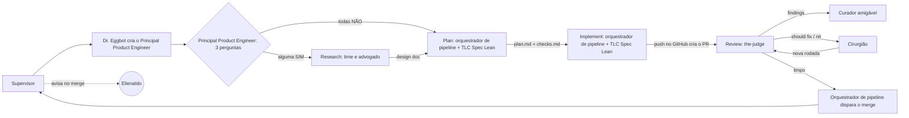

# Fábrica agêntica

Visão geral e regras da fábrica agêntica de software, no estado atual. Cada agente tem a sua ficha individual na pasta `modelos` (formato do Dr. Eggbot); este documento guarda o que é comum a todos: fluxo, regras, política de modelos, skills, ciclo de vida e pontos de atenção.

Dono do documento: Elienaldo Bittencourt. Redigido pelo Mestre de obras.

Legenda: itens marcados com **[proposta]** são sugestões minhas que o humano não pediu explicitamente. Confirme antes de tratar como regra.

---

## 1. Visão geral da fábrica agêntica

A fábrica recebe uma demanda e entrega código mergeado. Cada feature roda dentro de uma **sessão nomeada**, com a sua squad, criada e destruída pelo Dr. Eggbot.

### Fluxo, em fases

1. **Entrada:** fase sem diagrama próprio; descrita a partir das fichas do Supervisor e do Principal Product Engineer.
   - **Atores:** Supervisor (transversal e permanente), Dr. Eggbot e Principal Product Engineer; o humano só entra se faltar o projeto.
   - **Como acontece:** o Supervisor recebe a demanda (ticket, texto ou outra fonte). Só pergunta ao humano de qual projeto é a feature (nome ou caminho) se a demanda não trouxer. Cria a sessão nomeada em minúsculo, `feat/<nome-da-feature>` ou `fix/<nome-da-feature>`, e pede ao Dr. Eggbot o Principal Product Engineer, que sempre existe. Em seguida passa a feature ou a solicitação a ele. O Supervisor não classifica, não desenha, não implementa e não opina sobre o produto.
2. **Classificação:** é a porta de entrada do diagrama da fase research (`fase-research-v2`).
   - **Atores:** Principal Product Engineer, que atua como guardião do escopo.
   - **Como acontece:** o Principal Product Engineer recebe o pedido de feature e o classifica com 3 perguntas: muda arquitetura? Mexe em mais de um serviço? O requisito é ambíguo? Se alguma resposta for SIM, a feature vai para o research. Se todas forem NÃO, a feature é pequena: pula o research e entra no plan como solicitação direta. Nessa entrada ele também audita as skills do fluxo (the-judge, TLC Spec Lean, grill-me, wayfinder e prototype) e instala as que faltarem, sem pedir permissão; isso vale para qualquer skill, inclusive o wayfinder.
3. **Research** (só se a classificação mandar):
   - **Atores:** Principal Product Engineer e Product Engineer (produto e engenharia, mesmo peso de voto, modelos de famílias diferentes), design de front-end, advogado do diabo e, em caso de impasse, o humano.
   - **Como acontece:** o time de research discute a feature e cada área toma uma posição. O Principal Product Engineer e o Product Engineer decidem o como técnico, cada um com a sua visão, e também cuidam do escopo e da prioridade; o design de front-end desenha a experiência e decide o front. O advogado do diabo só levanta objeções enumeradas e justificadas, não vota e trava a fase enquanto houver objeção sem resposta. O time usa as skills grill-me (perguntas duras, pode ser usada em qualquer projeto), wayfinder (mapa de projeto, pode substituir o grill-me em projeto muito grande e de alta complexidade; quem avalia e decide é o Principal Product Engineer, e o humano é acionado se ele não conseguir decidir) e prototype (protótipo descartável do designer quando há dúvida visual ou de interação).
   - **Consenso:** as posições vão para o consenso por área (produto e engenharia: escopo, prioridade e como técnico; design: front). Sem consenso, abre nova rodada, no máximo 2. Sem consenso depois de 2 rodadas, o humano decide.
   - **Saída:** com o consenso, ou com a decisão humana, o research produz o **design doc** (problema, opções, decisão e trade-offs), que segue para a fase plan.
4. **Plan:**
   - **Atores:** Principal Product Engineer (entrega o insumo), Orquestrador de pipeline, modelo do Cursor (executa a skill TLC Spec Lean) e o humano, quando é avisado.
   - **Como acontece:** o Principal Product Engineer entrega ao orquestrador o design doc, vindo do research, ou a solicitação direta (texto, ticket do Notion ou do Jira, ou um ajuste), quando a feature pulou o research. O **Orquestrador de pipeline** solicita ao Cursor uma nova sessão com contexto limpo, passando todas as informações e o modelo (informado ou padrão), e pede ao modelo que dispare a skill **TLC Spec Lean** em modo plan. Regra: sempre pedir o planejamento E os checks; senão a skill só gera o `plan.md`. A skill gera os artefatos na pasta da feature: `plan.md` (o que o humano lê e contesta), `checks.md` (obrigações com prova, base do implement), `verification.md` (reservado, escrito pela própria skill na verificação, depois do build), `STATE.md` (decisões do projeto) e `LESSONS.md` (gerado a partir de falhas, nunca à mão).
   - **Saída:** com a pasta pronta, o orquestrador checa o resultado. Se falhou ou precisa de humano, o orquestrador reporta ao Supervisor, que avisa o humano, e o humano decide. Se não, segue para o implement com o caminho da pasta da feature.
5. **Implement:**
   - **Atores:** Orquestrador de pipeline, modelo do Cursor (o menos custoso, executa a skill TLC Spec Lean) e o humano, que recebe a escalada.
   - **Como acontece:** o orquestrador de pipeline solicita ao Cursor uma nova sessão com contexto limpo e pede ao modelo que dispare a skill **TLC Spec Lean** em modo implement, passando o projeto, a feature atual e o caminho da pasta da feature (com `plan.md`, `checks.md`, `verification.md`, `STATE.md` e `LESSONS.md`); o modelo é opcional. Dentro da skill, tudo roda local: o build executa o que foi planejado, os testes unitários rodam a partir dos checks do plan e, depois da implementação, a skill executa a verificação, uma subtarefa interna dela, que confere se está tudo verde. Regra: teste vermelho é parada, e a asserção nunca é enfraquecida.
   - **Correção:** se ficar vermelho, abre uma rodada de correção e volta para os testes, até 3 rodadas. Se ainda estiver vermelho depois de 3 rodadas, escala ao humano.
   - **Saída:** com tudo verde, a skill faz o handoff final ao orquestrador com o caminho da pasta da feature. O orquestrador então solicita ao modelo do Cursor um push no GitHub; o push gera o PR automaticamente e encerra a fase implement.
6. **Review:**
   - **Atores:** Orquestrador de pipeline, modelo do Cursor (executa a skill the-judge), Curador amigável, Cirurgião e o humano.
   - **Como acontece:** com o PR aberto, o orquestrador de pipeline solicita ao Cursor uma nova sessão, antes de passar qualquer informação, e passa projeto, feature e número do PR. Em seguida solicita ao modelo (padrão ou específico) que dispare a skill **the-judge** para efetuar um **review do PR**, passando o número do PR (`--pr <número>`) e o modelo. A the-judge classifica os findings em blocker, should fix e nit, faz no máximo 3 rodadas por execução, e cada nova rodada revisa só o diff novo.
   - **Curador amigável:** pega o resultado do review da skill the-judge e o transforma em um HTML visual e amigável, com linguagem direta e simples para qualquer senioridade de engenheiro, exibido no app do Grok Bot. Destaca os blockers e os itens não bloqueantes e, principalmente, o que precisa de decisão humana, para que a decisão seja informada. Não corrige, não reclassifica e não muda a severidade. Se o review vier limpo, não gera HTML.
   - **Cirurgião:** corrige sozinho os itens de should fix e nit, mexendo só no necessário, e devolve o PR para a the-judge revisar de novo. Should fix complexo ou com risco vai para o humano. Quando há **blocker**, o cirurgião nunca corrige por conta própria: solicita intervenção humana, e só corrige o blocker com autorização do humano (que pode trazer uma sugestão de correção); nesse caso a the-judge valida e, se passar, o merge é automático, sem nova avaliação humana. **Limite de loops:** no máximo 3 rodadas de correção; se estourar as 3 rodadas, ele obrigatoriamente para, trava e chama intervenção humana.
   - **Travas anti-loop:** 3 rodadas com blocker param e escalam ao humano; should fix 3 vezes seguidas depois do cirurgião trava; blocker novo sempre vai para o humano; should fix complexo ou com risco vai para o humano.
7. **Merge:** fase sem diagrama próprio; descrita a partir do bloco "Merge automático" do diagrama `fase-pr`.
   - **Atores:** Orquestrador de pipeline e, antes dele, a the-judge, que dá o veredito.
   - **Como acontece:** quando a última rodada da the-judge vem limpa e não há blocker pendente (nit pode ficar), o orquestrador de pipeline dispara o merge no GitHub. O PR mergeado é o handoff final da fábrica (ver ponto de atenção sobre isso na seção 6).
8. **Aviso:** o Supervisor avisa o humano no merge, pelo app do Grok Bot.

### Quem é quem

| Agente | Papel | Ficha |
| --- | --- | --- |
| Supervisor | Recebe a demanda, pergunta o projeto só se ela não trouxer, cria a sessão `feat/` ou `fix/`, pede ao Dr. Eggbot o Principal Product Engineer e coordena do pedido ao merge; transversal e permanente; único canal de comunicação com o humano: recebe as mensagens dos bots e repassa ao humano quando necessário; avisa o humano no merge pelo app do Grok Bot e, depois do ok final, pede ao Dr. Eggbot a destruição da sessão. | `supervisor.md` |
| Dr. Eggbot | Cria e destrói os bots e os chats da sessão. | ainda sem ficha no formato novo |
| Principal Product Engineer | Entrada da feature na squad, guardião do escopo e engenheiro mais experiente; é acordado pelo Supervisor e sempre existe na sessão; classifica a feature com 3 perguntas (research ou atalho direto ao plan); audita as skills do fluxo e instala as que faltarem; decide entre grill-me e wayfinder e, se não conseguir, aciona o humano; no research tem o mesmo peso de voto do Product Engineer e, junto com ele, decide o como técnico; no plan entrega ao orquestrador o design doc ou a solicitação direta. | `principal-product-engineer.md` |
| Product Engineer | Segundo engenheiro de produto, com o mesmo peso de voto do Principal Product Engineer; junto com ele, decide o como técnico no research. | `product-engineer.md` |
| Design de front-end | Especialista em front-end: decide a experiência (UX e UI), cria o protótipo descartável quando há dúvida visual ou de interação e fecha o consenso da área de design. | `design-front-end.md` |
| Advogado do diabo | Levanta objeções enumeradas e justificadas; não vota, não decide e não propõe solução; trava a fase enquanto houver objeção sem resposta. | `advogado-do-diabo.md` |
| Orquestrador de pipeline | Atua em plan, implement e review: solicita ao Cursor uma sessão nova com contexto limpo por fase; pede ao modelo que dispare a TLC Spec Lean (plan e implement) e a the-judge (review do PR, com número do PR e modelo); pede o push que cria o PR; dispara o merge. | `orquestrador-de-pipeline.md` |
| Cirurgião | Corrige should fix e nit do PR e devolve à the-judge; escala should fix complexo; blocker só com autorização humana; máximo de 3 rodadas de correção, depois trava e escala ao humano. | `cirurgiao.md` |
| Curador amigável | Transforma os findings da the-judge em HTML amigável no app do Grok Bot, destacando o que precisa de decisão humana; não corrige nem muda severidade. | `curador-amigavel.md` |

---

## 2. Regras gerais

### 2.1 Sessão nomeada e ID por feature (paralelismo)

- Cada feature tem uma sessão cujo nome é o prefixo em minúsculo mais o nome da feature:
  - `feat/<nome-da-feature>` para feature nova.
  - `fix/<nome-da-feature>` para correção.
- O nome da feature em formato slug (minúsculas, hifens) é o **ID da feature**. Tudo da feature leva esse ID: sessão, pasta, branch, PR, nome dos agentes da squad.
- O ID separa o trabalho de features diferentes, então várias features rodam **em paralelo**, cada uma com a sua squad, sem compartilhar estado.
- Se o ID já existir ativo, o Dr. Eggbot recusa a criação e devolve ao Supervisor, em vez de reaproveitar a squad.
- Cada feature tem uma pasta própria; o caminho dela viaja junto com o design doc no handoff.

### 2.2 Sessões das fases são pedidas ao Cursor

A abertura de sessão de cada fase (plan, implement, review) é sempre solicitada ao **Cursor**, nunca ao modelo. O modelo entra como parâmetro da solicitação e só roda skills e executa ações.

### 2.3 Consenso por área

No research, cada área decide o que é seu:

| Área | Decide |
| --- | --- |
| Produto e engenharia (Principal Product Engineer e Product Engineer, mesmo peso de voto) | escopo, prioridade e o como técnico |
| Design (front-end) | o front |

O consenso é por área, não por maioria geral. A prioridade única dos engenheiros de produto é entregar valor ao usuário. Sem consenso depois de 2 rodadas, o humano desempata.

### 2.4 Advogado do diabo sem voto

O advogado do diabo **não vota**. Só levanta objeções, enumeradas e justificadas. A fase **não avança** enquanto houver objeção sem resposta registrada (ele trava a fase).

### 2.5 Design doc como saída padrão do research

A saída do research é sempre o **design doc** (problema, opções, decisão e trade-offs). Ele é o que o plan recebe.

### 2.6 Classificação e atalho

O Principal Product Engineer faz 3 perguntas: a feature **muda arquitetura**? **Mexe em mais de um serviço**? Tem **ambiguidade de requisito**? Qualquer SIM manda para o research. Todas NÃO vão pelo atalho direto ao plan, sem research.

### 2.7 Skills que faltam

O Principal Product Engineer audita as skills do fluxo (the-judge, TLC Spec Lean, grill-me, wayfinder e prototype). Se faltar alguma, ele avisa e instala sem pedir permissão ao humano, porque a fábrica é automatizada e não pode parar por falta de skill. Isso vale para qualquer skill, inclusive o wayfinder.

### 2.8 Limites de rodadas

- Implement: até 3 rodadas de correção na verificação; depois escala ao humano.
- the-judge: máximo de 3 rodadas de revisão por execução.
- Cirurgião: máximo de 3 rodadas de correção; depois trava e escala ao humano.

### 2.9 Regras para o humano

- **Blocker é sempre humano.** O cirurgião não corrige blocker sozinho; se o humano não intervir, o fluxo trava e escala.
- Should fix complexo escala ao humano.
- Toda comunicação com o humano passa pelo Supervisor.
- O humano pode, opcionalmente, direcionar a forma de correção. Não é obrigatório.

---

## 3. Política de modelos de LLM

O modelo concreto de cada agente é escolha do humano e do Dr. Eggbot na hora de criar, conforme o que estiver disponível e o preço.

Regra dos dois engenheiros de produto (Principal Product Engineer e Product Engineer): **modelos de famílias diferentes**, para que a discussão não seja a mesma opinião duas vezes.

A the-judge deve preferir um modelo de família diferente da que implementou **[proposta]**.

---

## 4. Skills

Skills não são agentes: são instruções que um agente carrega. Não há criação ou destruição de skill por feature.

### 4.1 the-judge

- **O que é:** skill de **review de PR**.
- **Quem usa:** o modelo, solicitado pelo orquestrador de pipeline na fase de review, em sessão nova do Cursor.
- **Como funciona:** até **3 rodadas** por execução; classifica cada finding em **blocker**, **should fix** ou **nit**. Nova rodada, depois de uma correção, só revisa o diff novo.
- **Saída:** findings, entregues ao curador amigável e ao cirurgião.
- **Observação:** o texto original da skill vem do humano; este documento só a descreve.

### 4.2 TLC Spec Lean

- **O que é:** skill de especificação e execução (nome real: `tlc-spec-lean`).
- **Usos na fábrica:**
  - **Plan:** gera na pasta da feature `plan.md` e `checks.md` (sempre pedir planejamento E checks), além de `verification.md` (reservado), `STATE.md` e `LESSONS.md`.
  - **Implement:** executa o que foi planejado. Os commits, os gates e a verificação são internos da skill, inclusive o Verifier, um subagente da própria skill, nunca o autor do código, que escreve o `verification.md`.
- **Quem usa:** o modelo do Cursor, disparado pelo orquestrador de pipeline, com o modelo da fase.

### 4.3 grill-me

- **O que é:** skill de **questionamentos**.
- **Quem usa:** o time de research; pode ser usada em qualquer projeto.

### 4.4 wayfinder

- **O que é:** skill de mapa de projeto; pode **substituir o grill-me** em projeto **muito grande e de alta complexidade**.
- **Quem decide:** o Principal Product Engineer avalia se usa o grill-me ou o wayfinder; se ele não conseguir decidir, o humano é acionado.
- **Instalação:** como qualquer skill do fluxo, é instalada sem pedir permissão quando falta.

### 4.5 prototype

- **O que é:** skill do **designer** para **protótipo descartável**, que nunca vira código de produção.
- **Quando usa:** dúvida visual ou de interação: feature nova, mudança grande de front-end ou pedido do humano.

---

## 5. Ciclo de vida da squad

| Momento | Quem faz | O quê |
| --- | --- | --- |
| Demanda chega | Supervisor | Recebe a demanda, abre a sessão `feat/<feature>` ou `fix/<feature>` e pede ao Dr. Eggbot o Principal Product Engineer. |
| Criação | Dr. Eggbot | Cria os agentes com o ID da feature. O Principal Product Engineer, o orquestrador de pipeline, o cirurgião e o curador amigável existem em toda sessão; o time de research só quando a classificação mandar. |
| Execução | Orquestrador de pipeline e squad | O orquestrador atua só dentro das fases plan, implement e review: solicita ao Cursor a abertura das sessões e dispara as skills. O Supervisor continua transversal e permanente. |
| Merge | Orquestrador de pipeline | Dispara o merge no GitHub quando a última rodada da the-judge vem limpa e não há blocker pendente. |
| Aviso | Supervisor | Avisa o humano no merge. |
| Destruição | Dr. Eggbot, a pedido do Supervisor | Depois do ok do humano sobre a finalização, destrói os bots e os chats exclusivos da sessão. Supervisor e Dr. Eggbot continuam. |
| Cancelamento | Supervisor, a pedido do humano **[proposta]** | Dr. Eggbot destrói a sessão sem merge. |

Pontos que o Dr. Eggbot deve receber como decisão:

- **Criar tudo de uma vez ou por fase?** Se a feature pega o atalho, os agentes de research não são usados. Sugestão **[proposta]**: criar os agentes de research só quando o Principal Product Engineer classificar como SIM.
- **Destruir quando?** Já decidido: depois do ok do humano sobre a finalização.

---

## 6. Pontos de atenção que o Mestre de obras vê

- **Aviso ao humano com dono único.** O Supervisor é o dono da comunicação com o humano, pelo app do Grok Bot. O orquestrador de pipeline e os demais bots reportam ao Supervisor e não avisam o humano diretamente, para não haver mensagem duplicada. O Supervisor repassa só o necessário, com tom claro e direto: o que aconteceu e se há decisão pendente.
- **Contadores de rodadas sem dono.** A proposta de o Supervisor guardar os contadores de rodadas saiu da ficha. Hoje ninguém guarda; o `STATE.md` da TLC Spec Lean não tem contador de rodadas.
- **Humano como saída de vários lugares** (desempate de consenso, should fix complexo, blocker, 3 rodadas estouradas). Sem prazo de resposta definido, a sessão fica parada. Defina o que fazer quando o humano não responde.
- **Merge depende só do veredito da the-judge.** Vale um gate de CI como segunda condição.
- **Diagramas desatualizados (ajuste adiado).** Pendências: no `fase-research-v2`, quem classifica aparece como "PRODUCT ENGINEER", sem "Principal"; no `fase-plan` e no `fase-implement`, faltam o Verifier e os commits como partes internas da skill TLC Spec Lean; o fluxo mermaid deste documento tem setas simplificadas (ex.: Plan → Implement só com `plan.md` + `checks.md`); `fase-pr` e `fase-implement` (e os `.md` das fases) ainda mostram componentes que não existem mais.
- **Fichas pendentes.** Falta a ficha no formato novo do Dr. Eggbot.
